# Digital BE Project Log Book — System Design

| | |
|---|---|
| **Document** | System Design Document (SDD) |
| **System** | Digital BE Project Log Book |
| **Institution** | Anantrao Pawar College of Engineering & Research, Computer Engineering |
| **Source specification** | Project Diary, Record No. `ACA/D/003B`, Revision `00`, DoI `01/02/2025` |
| **Version** | 1.0 |
| **Date** | 22 October 2026 |
| **Status** | Reflects the implemented codebase in this repository |

---

## Table of contents

1. [Purpose and scope](#1-purpose-and-scope)
2. [Actors and responsibilities](#2-actors-and-responsibilities)
3. [Functional overview](#3-functional-overview)
4. [System architecture](#4-system-architecture)
5. [Data design](#5-data-design)
6. [Module design](#6-module-design)
7. [Core workflows and state machines](#7-core-workflows-and-state-machines)
8. [Authorization design](#8-authorization-design)
9. [Completion engine](#9-completion-engine)
10. [Paper-page and PDF subsystem](#10-paper-page-and-pdf-subsystem)
11. [Interfaces](#11-interfaces)
12. [Cross-cutting design](#12-cross-cutting-design)
13. [Security and privacy](#13-security-and-privacy)
14. [Non-functional design](#14-non-functional-design)
15. [Deployment](#15-deployment)
16. [Testing and quality assurance](#16-testing-and-quality-assurance)
17. [Known limitations and future work](#17-known-limitations-and-future-work)
18. [Appendix: status and action catalogue](#18-appendix-status-and-action-catalogue)

---

## 1. Purpose and scope

### 1.1 Problem

The department maintains a paper **Project Diary** for every BE project group. Students fill in
cover details, member information, rules acknowledgements, undertakings, topics, monthly activity
charts, reviews, marks, examiner feedback, checklists, competition and publication evidence, and
(when applicable) sponsored-project records. Guides countersign entries and award marks; the HOD
approves topics, marks and group formation and controls whether the final PDF may be generated.

The paper process has three practical problems:

1. **No single source of truth.** Entries, signatures and marks are spread across pages and files.
2. **Weak enforcement.** Nothing prevents an unauthorised person from writing marks, editing a
   verified row, or producing a final PDF with missing sections.
3. **No audit trail.** Corrections and approvals cannot be reconstructed reliably.

### 1.2 Goals

- Digitise every page of the diary while preserving the printed A4 look.
- Enforce the college workflow on the **server**: student → guide (reviewer) → HOD.
- Guarantee that only the assigned guide writes marks, grades, remarks and topic scores.
- Lock approved marks and allow only the HOD to unlock them with a written reason.
- Provide two-step signatures for activity entries and a full audit trail for every change.
- Compute completion objectively and gate final PDF generation on permission **and** completeness.
- Support the same UI on desktop and mobile, and produce a print/PDF copy from the same components.
- Stay deployable as a single web service with a managed PostgreSQL database and object storage.

### 1.3 Non-goals

- Replacing the university’s examination or result system.
- Separate reviewer accounts (the guide is the reviewer).
- External-examiner or sponsor logins (their names and signatures are recorded by staff/students).
- Real-time collaborative editing, offline mode, or native mobile apps.
- Payment, attendance, timetable or HR functionality.

### 1.4 Design principles

1. **Server-authoritative.** Hiding a button is never the security boundary. Every server action
   and route re-resolves the caller and re-checks role, ownership, group state and workflow state.
2. **Modular monolith.** One deployable Next.js application with clear internal layers, not a
   distributed system. This keeps multi-row approval/signature operations transactional.
3. **Workflow over free-form editing.** Marks and reviews move through explicit states; approved
   rows are immutable until an HOD-audited unlock.
4. **One rendering path.** The on-screen sheet and the PDF are the same React components. There is
   no second PDF template that can drift.
5. **Append-only evidence.** Every create, update, approval, unlock and PDF generation writes an
   `AuditLog` row; signatures are user id + display name + timestamp.
6. **Portable schema.** Enum-like values are strings and structured values are JSON text, so the
   Prisma schema stays portable between PostgreSQL and SQLite. Helpers centralise JSON handling.

---

## 2. Actors and responsibilities

| Actor | Account? | Responsibilities | Restrictions |
|---|---|---|---|
| **Student** | Yes, self sign-up | Create/join one group (max 4), fill the logbook, confirm activities, acknowledge rules/undertaking, add competitions, papers, checklists, RTM/cost, notes, sponsored rows, generate the PDF when allowed | Cannot write marks/grades/topic scores, cannot verify activities, cannot approve anything |
| **Guide / Reviewer** | Yes, HOD-created | One guide per group. Verify activities, score topics, fill/submit reviews and mark sheets, approve marks, countersign sponsored meetings, edit schedule dates | Only assigned groups; cannot approve/reject topics (HOD), cannot unlock marks, cannot administer users |
| **HOD** | Yes, seeded (additional HODs provisioned at database level) | Create guides, approve/reject groups, assign exactly one guide, approve/reject topics, approve marks, unlock with a reason, toggle PDF permission and sponsored flag, edit schedule, view audit log and media gallery | Cannot enter/edit marks, grades, remarks or topic scores; no UI to create another HOD |
| **External examiner** | No | Ratings/remarks transcribed by the guide; external name recorded | No system access |
| **Sponsor / external guide** | No | Sponsor feedback and meeting signatures recorded by students/guide; seal scan uploaded | No system access |

Multiple HOD accounts are supported (the schema is not limited to one), and certain notification
fan-outs address all active HODs.

---

## 3. Functional overview

| # | Module | What it stores | Workflow |
|---|---|---|---|
| 1 | Cover | Department, academic year, group no., project title, area, guide name | Student edits; locks after PDF |
| 2 | Rules and Regulations | 13 static rules + one acknowledgement per member | Student signs per member |
| 3 | Group Information | Up to 4 members with TE result, roll no., mobile, exam seat no., email, contribution, photo | Student edits; server enforces format/uniqueness |
| 4 | Undertaking | Fixed undertaking text with group values + per-member acceptance | Student accepts per member |
| 5 | Schedule | Semester I and II rows, dates | HOD/guide edit; others read |
| 6 | Topic Finalization | Topic 1 and Topic 2: title, description, four 0–10 scores, Yes/No recommendation, HOD decision | Student → guide → HOD |
| 7 | Activity Charts | 11 months (June–March, May–June), planned rows, date, Complete/Incomplete, student sign, guide sign | Two-step signature |
| 8 | Reviews | 7 templates: 3 Term-I (10/12/17 q), 4 Term-II (13/10/9/9 q), remarks, grades, per-row dates, guide sign | DRAFT → SUBMITTED → APPROVED |
| 9 | Mock Evaluation | Per-member Term-I table, 7 components, total 50 | DRAFT → SUBMITTED → APPROVED |
| 10 | Final Evaluation | Per-member Term-II table, 7 components, total 100 | DRAFT → SUBMITTED → APPROVED |
| 11 | Examiner Feedback | Term-I and Term-II, 9 ratings + remarks, external/internal names | Guide records |
| 12 | Submission Checklists | Term-I (5 items), Term-II (8 items including CD contents) | Tick list |
| 13 | Competitions | Name, date, college/level, Poster/Demo/Paper Presentation, award, certificate upload | Student CRUD |
| 14 | Papers | Title, conference, ISSN, volume/issue, page, file upload | Student CRUD |
| 15 | Sponsored Project | Semester 1/2 meeting logs + 7-parameter sponsor feedback + seal | Only when group is sponsored |
| 16 | Notes / RTM / Cost | Free text and/or attachments | Student CRUD |
| 17 | Completion | Aggregated section status, percent, missing list | Read-only |
| 18 | PDF Export | A4 PDF, `PdfExport` row, group locked | HOD permission + all sections complete |
| 19 | Notifications | In-app inbox + email | Event-driven |
| 20 | Administration | Users, groups, assignments, audit log, gallery, schedule | HOD |

Static content (rules, undertaking text, checklist items, rubric maxima, examiner questions) is
defined in `apps/web/lib/constants.ts`; seedable content (schedule, 53 activity rows, 7 review templates and
questions) lives in `prisma/seed-data/` and is loaded by `prisma/seed.ts`.

---

## 4. System architecture

### 4.1 System context

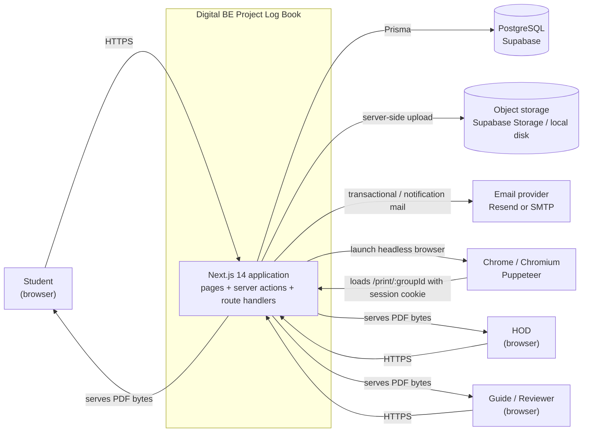

### 4.2 Containers and layers

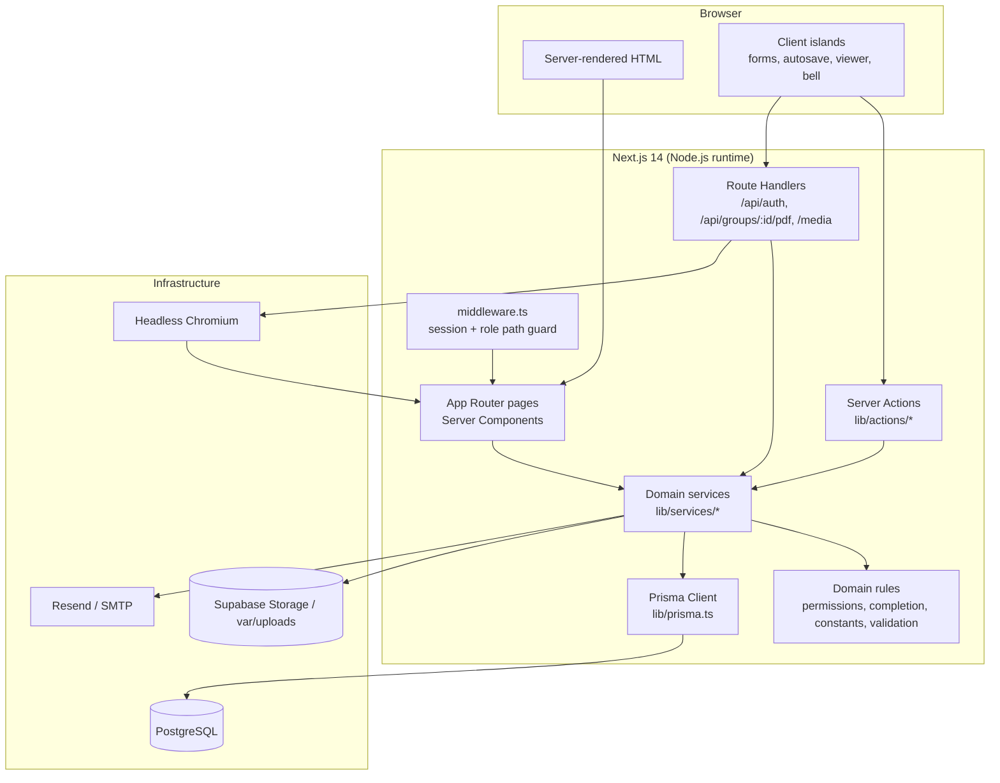

| Layer | Location | Responsibility |
|---|---|---|
| Edge guard | `apps/web/middleware.ts` | Requires a session for `/student`, `/guide`, `/hod`; redirects cross-role paths to the user’s home |
| Presentation | `apps/web/app/**/page.tsx`, `apps/web/components/**` | Server Components fetch data; client islands handle editing, autosave and the viewer |
| Transport | `apps/web/lib/actions/*.ts`, route handlers | Resolve the session, call a service, convert errors to `{ success, error }` or HTTP status |
| Application/domain | `apps/web/lib/services/*.ts`, `apps/web/lib/permissions.ts`, `apps/web/lib/completion/*`, `apps/web/lib/validation/*` | Permission checks, workflow state guards, invariants, transactions, audit, notifications |
| Data access | `apps/web/lib/prisma.ts`, `prisma/schema.prisma` | Typed database access and schema |
| Infrastructure adapters | `apps/web/lib/upload.ts`, `apps/web/lib/email.ts`, `apps/web/lib/services/pdf.ts` | Storage, email, Puppeteer |

### 4.3 Request lifecycle

**Read (page render):**

1. `apps/web/middleware.ts` verifies the JWT session and the `/student`, `/guide` or `/hod` prefix.
2. The Server Component calls `requireUser()` or `requireRole(...)` (`apps/web/lib/permissions.ts`).
3. The page resolves the user’s group/membership (or the assigned group for a guide).
4. It calls domain services, which also check `canViewGroup` and materialise missing rows if needed
   (for example activity entries, review forms or mark-sheet rows).
5. The page renders the paper sheet inside the viewer shell, or a dashboard card.

**Write (server action):**

1. The action re-resolves the caller from the session; it never trusts a user id or role in the form.
2. Input passes through the module’s Zod schema.
3. The service checks the actor’s role, the group ownership/assignment and the current state.
4. Multi-row writes run in `prisma.$transaction` together with `logAction`.
5. After the transaction, the service emits best-effort notifications (in-app row + email).
6. The action returns `{ success: true, data }` or `{ success: false, error }`; the client shows
   inline feedback and, where needed, calls `router.refresh()`.

There is no internal REST API for normal page data; Server Components call services directly. REST
route handlers exist only where a non-React consumer or a browser navigation needs them (NextAuth,
PDF download, media files).

### 4.4 Key architectural decisions

| Decision | Rationale | Consequence |
|---|---|---|
| **Modular monolith** | Workflow transitions touch several tables and must be atomic; the user base is one department | One deployment; scale vertically first |
| **Server Components + Server Actions** | Keeps permission checks and data access on the server; less client code | Pages are dynamic; no separate public API needed |
| **Service layer between actions and Prisma** | Same business rules serve pages, actions and tests | Actions stay thin; tests call services directly |
| **PostgreSQL + Prisma** | Reliable transactions, managed hosting, typed access | Requires a database service; Prisma migrations in deployment |
| **Enum-like values as `String`** | Portable to SQLite; avoids migration churn | Validation in `apps/web/lib/constants.ts` + Zod, not DB enums |
| **JSON stored as text** | Portable and easy to evolve | Must use `apps/web/lib/json.ts`; no DB-level JSON queries |
| **JWT sessions** | Simple credential auth, no session table | Revocation is limited to token expiry (see §13) |
| **Same Sheet components for screen and PDF** | Guarantees visual parity | Print route must be renderable server-side and must re-check access |
| **Synchronous Puppeteer render** | Few exports; simple operational model | PDF request occupies the web process for seconds |
| **Storage abstraction (`local` / `supabase`)** | Local development without cloud credentials; durable production files | Production needs a Supabase bucket and server-side key |

---

## 5. Data design

### 5.1 Domain groupings

- **Identity:** `User`, `EmailVerificationToken`, `PasswordResetToken`
- **Group formation:** `Group`, `GroupMember`, `GroupInvite`
- **Static/seedable content:** `ScheduleItem`, `ActivityTemplate`, `ReviewTemplate`, `ReviewQuestion`
- **Academic record:** `TopicProposal`, `ActivityEntry`, `ActivityEntryHistory`, `ContentPage`,
  `ReviewForm`, `ReviewScore`, `MarksSheet`, `ExaminerFeedback`, `Checklist`
- **Evidence:** `Competition`, `PaperPublication`, `SponsoredMeeting`, `SponsorFeedback`
- **Operations:** `PdfExport`, `Notification`, `AuditLog`

### 5.2 Entity–relationship model

```mermaid
erDiagram
    User {
        string id PK
        string name
        string email UK
        string rollNo UK
        string role
        boolean active
    }
    Group {
        string id PK
        string code UK
        string groupNo
        string status
        string guideId FK
        string creatorId FK
        boolean isSponsored
        boolean pdfPermission
    }
    GroupMember {
        string id PK
        string groupId FK
        string userId FK
        string rollNo
        string examSeatNo
        datetime rulesAckAt
        datetime undertakingAcceptedAt
    }
    TopicProposal {
        string id PK
        string groupId FK
        int topicNo
        string status
    }
    ActivityEntry {
        string id PK
        string groupId FK
        string templateId FK
        string month
        string status
        string statusText
        int version
    }
    ReviewForm {
        string id PK
        string groupId FK
        string templateId FK
        string status
    }
    ReviewScore {
        string id PK
        string formId FK
        string questionId FK
        string grade
        datetime guideSignedAt
    }
    MarksSheet {
        string id PK
        string groupId FK
        string memberId FK
        string kind
        string components
        int total
        string status
    }
    ExaminerFeedback {
        string id PK
        string groupId FK
        string term
        string answers
    }
    Checklist {
        string id PK
        string groupId FK
        string term
        string items
    }
    Competition {
        string id PK
        string groupId FK
        string name
        string type
        string certificateUrl
    }
    PaperPublication {
        string id PK
        string groupId FK
        string title
        string fileUrl
    }
    SponsoredMeeting {
        string id PK
        string groupId FK
        string semester
        int sortOrder
    }
    SponsorFeedback {
        string id PK
        string groupId FK
        string ratings
        string sealUrl
    }
    PdfExport {
        string id PK
        string groupId FK
        string generatedById FK
        string fileUrl
    }
    AuditLog {
        string id PK
        string userId FK
        string action
        string entity
        string entityId
        string before
        string after
        datetime timestamp
    }

    User ||--o{ GroupMember : "joins"
    User |o--o{ Group : "guides"
    User ||--o{ Group : "creates"
    User ||--o{ GroupInvite : "sends"
    User ||--o{ AuditLog : "acts"
    Group ||--|{ GroupMember : "has"
    Group ||--o{ GroupInvite : "issues"
    Group ||--o{ TopicProposal : "proposes"
    Group ||--o{ ActivityEntry : "logs"
    ActivityTemplate ||--o{ ActivityEntry : "instantiates"
    ActivityEntry ||--o{ ActivityEntryHistory : "versions"
    Group ||--o{ ContentPage : "owns"
    Group ||--o{ ReviewForm : "has"
    ReviewTemplate ||--o{ ReviewForm : "instantiates"
    ReviewTemplate ||--o{ ReviewQuestion : "asks"
    ReviewForm ||--o{ ReviewScore : "scores"
    ReviewQuestion ||--o{ ReviewScore : "answers"
    Group ||--o{ MarksSheet : "has"
    GroupMember ||--o{ MarksSheet : "receives"
    Group ||--o{ ExaminerFeedback : "has"
    Group ||--o{ Checklist : "has"
    Group ||--o{ Competition : "enters"
    Group ||--o{ PaperPublication : "publishes"
    Group ||--o{ SponsoredMeeting : "holds"
    Group ||--o{ SponsorFeedback : "receives"
    Group ||--o{ PdfExport : "exports"
```

`Notification`, `EmailVerificationToken` and `PasswordResetToken` are omitted from the diagram for
readability; they attach directly to `User`.

### 5.3 Entity catalogue

| Entity | Purpose | Key fields | Constraints |
|---|---|---|---|
| `User` | Login identity for all three roles | `email`, `rollNo`, `role`, `passwordHash`, `emailVerifiedAt`, `active`, `createdVia` | `email` unique; `rollNo` unique when present |
| `EmailVerificationToken` | Single-use signup verification | `tokenHash`, `expiresAt`, `usedAt` | Indexed by user; raw token never stored |
| `PasswordResetToken` | Single-use password reset | `tokenHash`, `expiresAt`, `usedAt` | Indexed by user |
| `Group` | One BE project group | `code`, `groupNo`, `academicYear`, `department`, `projectTitle`, `area`, `guideId`, `status`, `pdfPermission` | `code` unique; one guide (nullable until assigned); one creator |
| `GroupMember` | Membership + printed member details | `name`, `teResult`, `rollNo`, `examSeatNo`, `mobile`, `email`, `contribution`, `photoUrl`, `rulesAckAt`, `undertakingAcceptedAt`, `memberType` | Unique `(groupId, userId)`; max 4 enforced in services |
| `GroupInvite` | Invite by email or roll number | `invitedEmail`, `invitedRollNo`, `code`, `status`, `expiresAt` | Pending/accepted/declined/expired |
| `TopicProposal` | Topic 1 or 2 | `title`, `description`, four scores, `guideRecommendation`, `status`, `approvedBy`, `rejectReason` | Unique `(groupId, topicNo)` |
| `ScheduleItem` | Semester I/II schedule | `term`, `sortOrder`, `description`, `date`, `note` | Unique `(term, sortOrder)` |
| `ActivityTemplate` | Planned activity per month | `month`, `sortOrder`, `text` | Unique `(month, sortOrder)` |
| `ActivityEntry` | One group’s row for one template | `date`, `status`, `statusText`, student/guide signer + time, `version` | Unique `(groupId, templateId)`; indexed `(groupId, month)` |
| `ActivityEntryHistory` | Snapshot before a re-confirm | `snapshot` (JSON text), `changedBy`, `changedAt` | Append-only in application code |
| `ContentPage` | RTM, cost estimation, notes | `type`, `richText`, `fileUrl`, `sortOrder` | Unique `(groupId, type, sortOrder)` |
| `ReviewTemplate` | One of 7 review sheets | `term`, `reviewType`, `title`, `order`, `hasDateColumn` | `reviewType` unique |
| `ReviewQuestion` | Seeded questions | `questionNo`, `text` | Unique `(templateId, questionNo)` |
| `ReviewForm` | One group’s review instance | `status`, `remarkAndSuggestions`, `guideId`, submit/approve fields, `unlockReason` | Unique `(groupId, templateId)` |
| `ReviewScore` | Per-question row | `remark`, `grade`, `date`, per-question guide sign | Unique `(formId, questionId)` |
| `MarksSheet` | One member’s mock/final row | `kind` (`MOCK_T1`/`FINAL_T2`), `components` (JSON text), `total`, `status`, approver, `unlockReason` | Unique `(groupId, memberId, kind)` |
| `ExaminerFeedback` | Term-I/II external feedback | `answers` (JSON array), `remarks`, `externalName`, `internalName` (guide), `date` | Unique `(groupId, term)` |
| `Checklist` | Term-I/II ticks | `items` (JSON array of `{text, checked}`) | Unique `(groupId, term)` |
| `Competition` | Competition evidence | `name`, `date`, `collegeAndLevel`, `type`, `award`, `certificateUrl` | Group-scoped |
| `PaperPublication` | Paper evidence | `title`, `conference`, `issn`, `volIssue`, `pageNo`, `fileUrl` | Group-scoped |
| `SponsoredMeeting` | Sponsored meeting log | `semester`, `sortOrder`, summaries, student/guide/external sign times | Unique `(groupId, semester, sortOrder)` |
| `SponsorFeedback` | 7 ratings + company + seal | `ratings` (JSON text), `company`, `sealUrl`, `signedAt` | Unique `(groupId)` |
| `PdfExport` | Generated artifact | `fileUrl`, `generatedBy`, `generatedAt` | Append-only log of exports |
| `Notification` | In-app inbox | `type`, `message`, `readAt` | Indexed by user |
| `AuditLog` | Business audit trail | `action`, `entity`, `entityId`, `before`, `after`, `timestamp` | Indexed `(entity, entityId)` and `timestamp` |

### 5.4 Invariants and where they are enforced

| Invariant | Enforcement |
|---|---|
| A student belongs to at most one group | Application check in `createGroup` / `invite` / `joinByCode` / `acceptInvite` (no global DB constraint) |
| A group has at most 4 members | Application check on every join path; counter in service |
| A group has exactly one guide | Single nullable `Group.guideId`; HOD assignment replaces it |
| Only one topic per `(group, topicNo)` | DB unique |
| Topic 2 exists only after Topic 1 is `REJECTED` | Service guard `assertTopic2Unlocked` on save, score and decision |
| One review form per `(group, template)` | DB unique |
| One mark sheet per `(group, member, kind)` | DB unique |
| One examiner feedback per `(group, term)` | DB unique |
| One checklist per `(group, term)` | DB unique |
| Roll number and exam seat number unique within a group | Application check in `updateMember` (no DB composite unique) |
| Approved marks are immutable | Service checks `status === APPROVED`; only HOD unlock changes state |
| Final PDF locks the group | `PDF_GENERATED` checked by every write service |
| Total marks are trustworthy | Server recomputes the sum; each cell checked against its rubric maximum |

> **Note.** The first, second and group-level uniqueness invariants are enforced in application
> code rather than by the database. They are covered by tests, but concurrent requests are not
> serialised. See §17 for hardening options.

### 5.5 Storage and type conventions

| Concern | Convention |
|---|---|
| Primary keys | `cuid()` strings |
| Timestamps | `DateTime`; rendered through `apps/web/lib/format.ts` as `Signed by <name> on <date time>` |
| Enum-like fields | `String`, values declared in `apps/web/lib/constants.ts` and validated by Zod |
| Structured data | JSON text (`components`, `answers`, `items`, `ratings`, audit `before`/`after`, activity history) read/written only through `apps/web/lib/json.ts` |
| Deletes | Group-owned records cascade from `Group`; users are referenced by optional relations |
| File URLs | Relative `/media/...` for local storage, absolute Supabase public URL in production |
| Session | JWT carrying `user.id` and `user.role`; no server session table |

---

## 6. Module design

### 6.1 Authentication and account lifecycle

**Flow:** self sign-up → optional domain restriction → email verification → login → password reset.

- `signupSchema` strips any client-supplied `role`; the service hard-codes `STUDENT`.
- Duplicate email and duplicate roll number are rejected before insert.
- Passwords are hashed with bcrypt (10 rounds).
- Verification token: 32 random bytes, raw token only in the email link, SHA-256 hash stored,
  24-hour expiry, single use. Password reset: same pattern, 1-hour expiry.
- Sign-up rolls the user back if the verification mail cannot be sent, so no unverifiable account is
  stranded. Forgot-password always returns a generic success message.
- `authenticate()` rejects inactive accounts, wrong passwords and (unless disabled) unverified email.
- NextAuth Credentials provider issues a JWT session; `jwt`/`session` callbacks copy `id` and `role`.
- Rate limits: sign-up and reset per client IP, login per email address.
- `ALLOWED_EMAIL_DOMAIN` optionally restricts self sign-up.
- `REQUIRE_EMAIL_VERIFICATION="false"` is a demo switch; default is verification required.

### 6.2 HOD administration

`apps/web/lib/services/admin.ts` provides:

- create/update/deactivate guide accounts (HOD-created, `createdVia = HOD_CREATED`);
- approve a `SUBMITTED` group **and** assign its guide in one transaction → `ACTIVE`;
- reject a `SUBMITTED` group back to `DRAFT` with a mandatory reason;
- assign/reassign a guide while `SUBMITTED` or `ACTIVE`;
- flag/unflag sponsored projects;
- toggle PDF permission (allow requires 100% completion);
- queue views for topics, reviews, marks and groups.

Every operation audits and most emit notifications. The HOD dashboard aggregates all groups with
guide, percent, missing sections, approval queue and PDF toggle.

### 6.3 Group formation

`apps/web/lib/services/group.ts`:

- create group (creator becomes member 1, `DRAFT`, shareable code);
- invite by email or roll number (target must be a registered student, not already grouped, group
  has capacity);
- accept/decline invite, join by code, remove member (creator only, while `DRAFT`);
- submit for approval (creator only, `DRAFT → SUBMITTED`);
- capacity and single-group checks on every path.

The HOD then approves with a guide; activity charts, topics and reviews unlock only when the group
is `ACTIVE` (rules and undertaking can be signed earlier).

### 6.4 Cover, members, rules and undertaking

- `group-info.ts`: cover/member autosave, photo upload (JPG/PNG, ≤ 2 MB), mobile/email validation,
  roll/exam-seat uniqueness within the group, PDF lock.
- `signoff.ts`: any member of the group may sign any member’s rules/undertaking row (one student can
  complete the group); the audit records the actual clicker; a second click keeps the original
  timestamp (idempotent); guides/HOD are refused.

### 6.5 Schedule

Global Semester I/II rows are seeded. HOD and guide may edit dates; students read-only. Dates are
free text (a range or “As per university schedule” is valid). Each save audits.

### 6.6 Topic finalization

- Student writes/saves a topic, then submits.
- Assigned guide scores four criteria 0–10 and records Yes/No.
- HOD approves or rejects with a reason.
- A rejected Topic 1 enables Topic 2; an approved Topic 1 makes Topic 2 unnecessary.
- Resubmission resets the previous scores/decision and starts a new round.
- Only the assigned guide may score; only the HOD may decide.

### 6.7 Activity charts

- 11 month tabs, 53 seeded planned rows (no April; May–June combined).
- Entries are materialised lazily per group/template when a chart is opened.
- Student sets date + Complete/Incomplete and confirms.
- Assigned guide verifies a student-confirmed row.
- Editing a guide-verified row resets it to `STUDENT_CONFIRMED`, clears the guide countersign,
  increments `version`, writes an `ActivityEntryHistory` snapshot, and requires fresh verification.

### 6.8 Reviews

Seven templates are seeded exactly as printed. On first open, the service materialises one
`ReviewForm` and one empty `ReviewScore` per question. The assigned guide fills remarks, grades and
(where the template has a date column) per-row dates, then submits; submission stamps every row
with the guide’s signature. The guide or HOD approves, which locks the form. Only the HOD unlocks,
with a mandatory reason, returning it to `DRAFT`.

### 6.9 Mock and final evaluation

Both tables share a generic core (`apps/web/lib/services/evaluation.ts`) parameterised by kind:

| Kind | Components | Total |
|---|---|---|
| `MOCK_T1` | Problem 5, Literature 5, Analysis 5, Modeling 10, Planning 5, Presentation 10, Report 10 | 50 |
| `FINAL_T2` | Modeling 10, Coding 40, Testing 10, Understanding 10, Teamwork 10, Demo 10, Documents 10 | 100 |

One row per member; rows are materialised lazily. The guide saves cells (validated against each
maximum), then submits the group table; the guide or HOD approves; only HOD unlocks with a reason.
Totals are always recomputed on the server. “Committee sign 1” is the latest submission audit;
“committee sign 2” is the approver.

### 6.10 Examiner feedback

Two terms, nine fixed questions rated Excellent/Good/Satisfactory, plus remarks, project title,
date, external examiner name, internal (guide) name. The assigned guide writes; students and HOD
read. Completion requires all nine valid ratings.

### 6.11 Records, sponsored projects and evidence

- Competitions, papers, checklists, RTM, cost and notes are student-owned CRUD.
- Uploads accept PDF/JPG/PNG up to 10 MB; documents are served through `/media` or Supabase URLs.
- Sponsored sheets appear only when the HOD flags the group. Students add meetings and sign their
  own row; the assigned guide countersigns; the external guide’s name/timestamp is recorded by the
  student (no account). Sponsor feedback stores seven High/Medium/Low ratings, company and a seal
  scan. Editing a signed meeting clears all signatures.
- The HOD has a read-only bundle per group plus a gallery of certificates and paper uploads.

### 6.12 Notifications, activity feed and audit

- Notification service writes in-app rows and sends email; failures never break the business action.
- The bell polls every 30 seconds; recent activity is role-scoped and polls every 10 seconds (with a
  Live/Paused control).
- Audit writes participate in the same Prisma transaction as the change they describe.

---

## 7. Core workflows and state machines

### 7.1 Group lifecycle

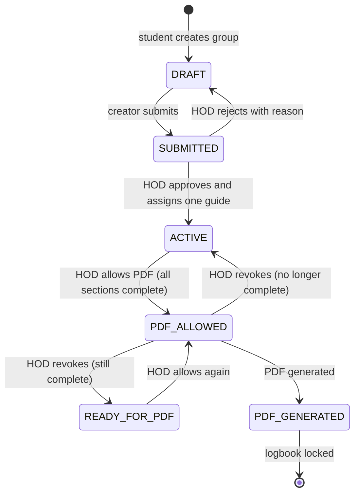

Notes:

- `ACTIVE` is the working state. Readiness for PDF is computed continuously by the completion
  engine, so the dashboard can show 100% while the group is still `ACTIVE`.
- `READY_FOR_PDF` is a convenience status set when PDF permission is revoked from a complete group;
  it is not a prerequisite for requesting permission.
- A group becomes writable for topics, activities, reviews, marks and examiner feedback only in
  `ACTIVE`, `READY_FOR_PDF` or `PDF_ALLOWED`. `PDF_GENERATED` is read-only.
- Records, rules, undertaking and cover can be edited before `ACTIVE`; they also lock at
  `PDF_GENERATED`.

### 7.2 Topic workflow

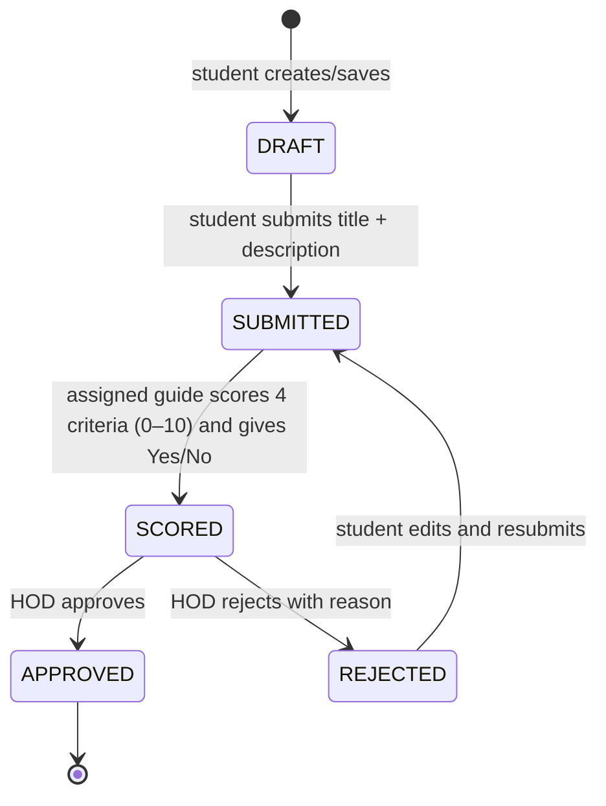

**Topic 2 rule:** a write/score/decision on Topic 2 is rejected unless Topic 1 is `REJECTED`.
While Topic 1 is a draft, submitted, scored or approved, Topic 2 is locked. If Topic 1 is approved,
Topic 2 is marked not required.

### 7.3 Activity two-step signature

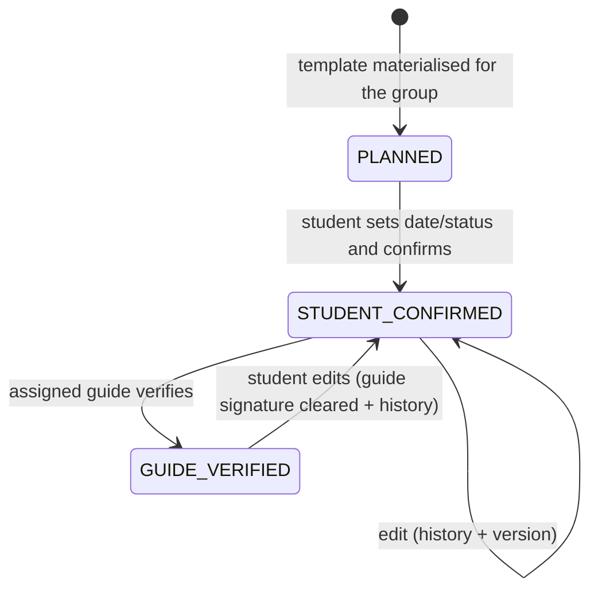

**Sequence:**

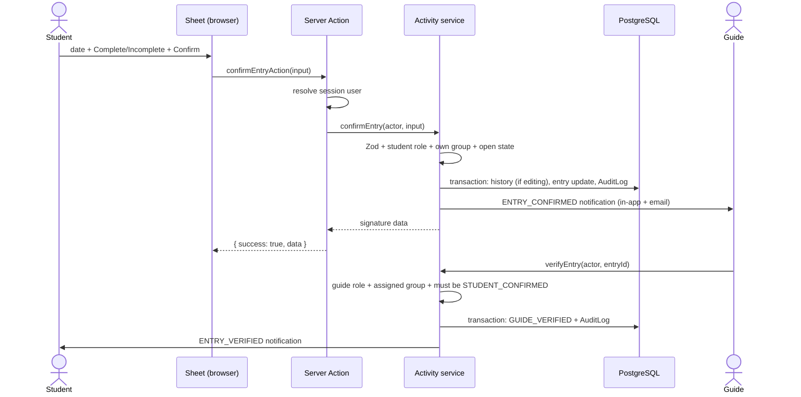

### 7.4 Reviews and mark sheets

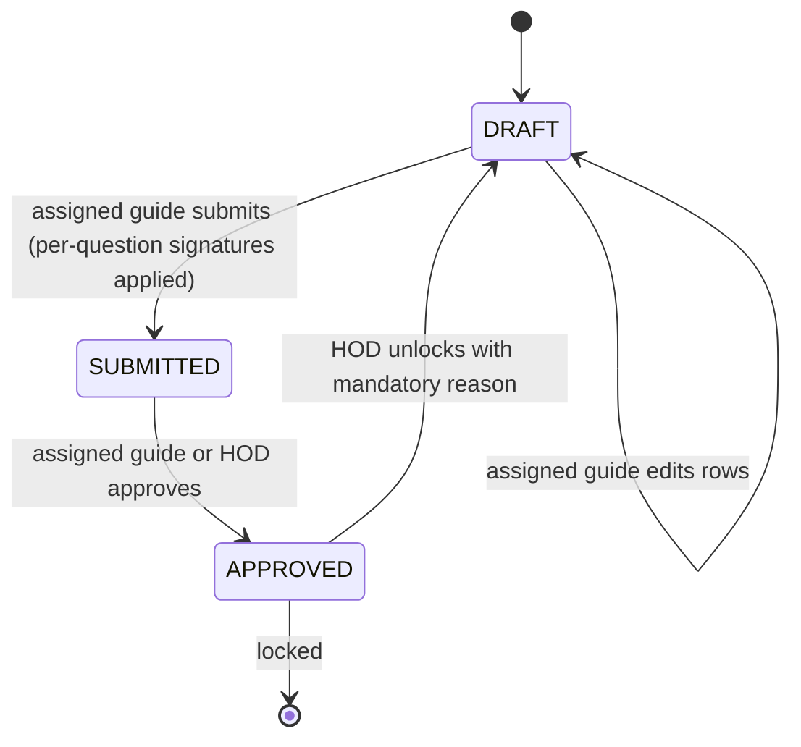

**Sequence (review):**

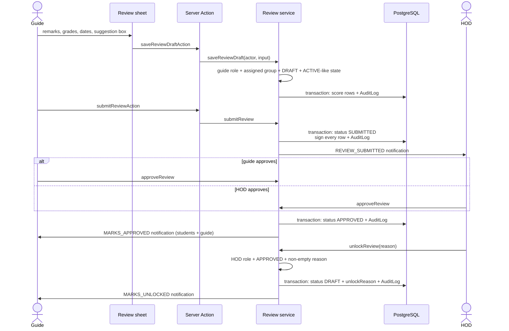

The same state machine applies to each `MarksSheet` row. The mock/final services act on all eligible
rows of a group at once (save, submit, approve, unlock), while each row retains its own status and
audit entries. Unlike reviews, mark-sheet rows have no per-question signature; the committee signs
are derived from the submission audit and the approval record.

### 7.5 Final PDF gate

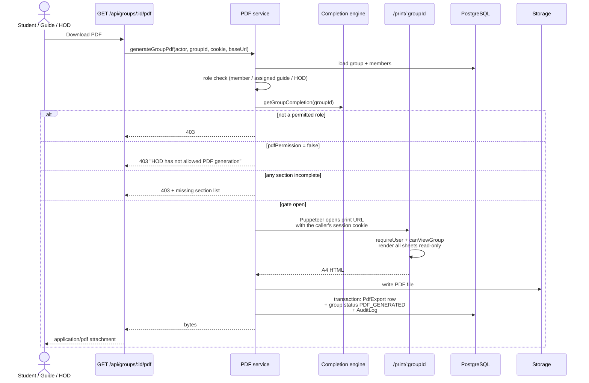

The gate is re-checked **inside** `generateGroupPdf`, not only on the UI button. Both conditions are
required:

```
canGeneratePdf = permittedRole ∧ pdfPermission ∧ allSectionsComplete
```

### 7.6 Notification triggers

| Event | Recipients | Type |
|---|---|---|
| Guide assigned | Group students + guide | `GUIDE_ASSIGNED` |
| Activity confirmed | Assigned guide | `ENTRY_CONFIRMED` |
| Activity verified | Group students | `ENTRY_VERIFIED` |
| Topic scored | All active HODs | `TOPIC_SCORED` |
| Topic approved/rejected | Group students | `TOPIC_DECIDED` |
| Review submitted | All active HODs | `REVIEW_SUBMITTED` |
| Marks approved | Students + guide | `MARKS_APPROVED` |
| Marks unlocked | Students + guide | `MARKS_UNLOCKED` |
| Group reaches 100% | All HODs, once (message-based dedup) | `GROUP_READY` |
| PDF permission granted/revoked | Group students | `PDF_PERMISSION` |

Each event writes an in-app `Notification` row and attempts an email. Notifications are
best-effort: failures are logged and never roll back the underlying transaction.

---

## 8. Authorization design

### 8.1 Role/resource matrix

Legend: **W** = write, **R** = read-only, **A** = approve only, **—** = no access.

| Capability | Student (own group) | Guide (assigned groups) | HOD |
|---|---|---|---|
| View group and sheets | R | R | R (all) |
| Edit cover / members / photos | W | — | — |
| Acknowledge rules / undertaking | W | — | — |
| Edit schedule dates | — | W | W |
| Write topic text | W | — | — |
| Score topic | — | W | — |
| Approve/reject topic | — | — | A |
| Confirm activity row | W | — | — |
| Verify activity row | — | W | — |
| Fill review (remarks/grades) | — | W | — |
| Submit review | — | W | — |
| Approve review | — | A | A |
| Unlock review | — | — | W (reason) |
| Fill/submit mock or final marks | — | W | — |
| Approve mark sheet | — | A | A |
| Unlock mark sheet | — | — | W (reason) |
| Write examiner feedback | — | W | — |
| Competitions / papers / checklists / RTM / cost / notes | W | R | R |
| Sponsored meetings | W (student sign) | W (countersign) | R |
| Sponsor feedback | W | R | R |
| Create group / invite / submit | W (creator) | — | — |
| Approve/reject group | — | — | A |
| Assign guide | — | — | W |
| Flag sponsored | — | — | W |
| Toggle PDF permission | — | — | W |
| Generate final PDF | W (own, gate) | W (assigned, gate) | W (all, gate) |
| Manage users, audit, gallery | — | — | R/W |

**Critical rule:** the HOD is deliberately read-only on marks content. The HOD can change the
*state* (approve, unlock) but cannot enter or edit marks, grades, remarks or topic scores.

### 8.2 Defence-in-depth layers

| Layer | Mechanism | What it stops |
|---|---|---|
| 1. Middleware | `withAuth` + `canAccessPath` | Anonymous users and cross-role page navigation |
| 2. Page | `requireUser` / `requireRole` | Direct URL access to another role’s section |
| 3. Service actor check | `canEnterMarks`, `assignedGroup`, role checks | A valid user writing another group’s data |
| 4. Resource ownership | membership / `guideId` / group id checks | IDOR via a guessed `groupId` |
| 5. State guard | `assertReviewOpen`, `assertChartOpen`, `assertTopic2Unlocked`, status checks | Workflow bypass (edit after approval, verify a planned row, Topic 2 before rejection) |
| 6. Validation | Zod schemas | Bad values, oversized text, over-max marks, missing reasons |
| 7. Completion gate | Server recomputation at PDF time | Stale or forged “100%” UI state |
| 8. UI | Hide/disable controls | Accidental misuse only (never relied on for security) |

Key helpers in `apps/web/lib/permissions.ts`:

```ts
canViewGroup(user, group)
canEditGroupInfo(user, group)
canEnterMarks(user, group)      // GUIDE + group.guideId === user.id
canApproveMarks(user, group)
canUnlockMarks(user)            // HOD only
canAssignGuide(user)            // HOD only
canTogglePdfPermission(user)    // HOD only
canApproveTopic(user)           // HOD only
isGroupActive(group)
canGeneratePdf(user, group, allSectionsComplete)
```

### 8.3 Group-state guards in write services

| Group status | Topics | Activities | Reviews / marks | Examiner | Records |
|---|---|---|---|---|---|
| `DRAFT` | Locked | Locked | Locked | Locked | Open (cover, members, records) |
| `SUBMITTED` | Locked | Locked | Locked | Locked | Open |
| `ACTIVE` | Open | Open | Open | Open | Open |
| `READY_FOR_PDF` | Open | Open | Open | Open | Open |
| `PDF_ALLOWED` | Open | Open | Open | Open | Open |
| `PDF_GENERATED` | Locked | Locked | Locked | Locked | Locked |

---

## 9. Completion engine

### 9.1 Contract

Each section exposes:

```ts
type SectionStatus = {
  key: string;
  label: string;
  href: string;
  complete: boolean;
  percent: number; // 0–100
};
```

The registry aggregates all sections:

```ts
type GroupCompletion = {
  sections: SectionStatus[];
  percent: number;   // mean of section percents
  complete: boolean; // every mandatory section complete
  missing: string[]; // labels of incomplete sections
};
```

Primary entry point: `getGroupCompletion(groupId)` in `apps/web/lib/completion/index.ts`.
Dashboard helpers: `getGuideOverview(guideId)` and `getHodOverview()`.

### 9.2 Completeness rules

| Section | Complete when |
|---|---|
| Cover | Department, academic year, project title, area, group no. filled **and** a guide assigned |
| Group information | Every member has name, TE result, roll no., mobile, exam seat no., email, contribution and photo |
| Rules | Every member has `rulesAckAt` |
| Undertaking | Every member has `undertakingAcceptedAt` |
| Topics | At least one `TopicProposal` with status `APPROVED` |
| Activity charts | Every `ActivityTemplate` has a row for the group with `GUIDE_VERIFIED` **and** `statusText = COMPLETE` |
| RTM | A `ContentPage` of type `RTM` has text or a file |
| Cost estimation | A `ContentPage` of type `COST` has text or a file |
| Reviews | All 7 review templates have an `APPROVED` form |
| Mock evaluation | Every member has an `APPROVED` `MOCK_T1` row |
| Final evaluation | Every member has an `APPROVED` `FINAL_T2` row |
| Examiner feedback | Both terms have all 9 valid ratings |
| Checklists | Both terms exist and every item is checked |
| Competitions | At least 1 competition entry |
| Papers | At least 1 paper publication |
| Sponsored project | Only if `isSponsored`: at least one meeting exists and every meeting has a guide countersignature, and feedback has company + all 7 ratings + seal |

### 9.3 Aggregation and consumers

- Overall percent = arithmetic mean of section percents (equal weight per section).
- `complete = missing.length === 0`.
- Consumers:
  - student dashboard stepper and PDF panel;
  - guide dashboard pending work;
  - HOD dashboard per-group percent and queue;
  - HOD “Allow PDF” action (refuses and returns the missing list);
  - PDF service gate;
  - `notifyIfReadyForPdf` (deduplicated once per group/message).

### 9.4 Performance characteristics

The engine is read-heavy: one `getGroupCompletion` performs roughly 15–20 queries (some in
parallel). The HOD dashboard calls it once per group, so cost grows as `O(groups × queries)`. This is
acceptable for a single department (tens of groups). If the college scales, cache a completion
snapshot per group and invalidate it on writes, or compute it in a background job.

---

## 10. Paper-page and PDF subsystem

### 10.1 Rendering model

Every logbook screen is an A4 sheet, not a dashboard card:

- `PaperPage` renders a fixed **794 × 1123 px** white sheet (A4 at 96 dpi) on a grey desk, with the
  repeated college header and optional page number.
- `CollegeHeader` repeats the crest, parishad/college name, record no., revision, DoI, portrait
  logo, and the grey **Project Diary** bar.
- `Field`, `SignCell`, `MarksCell`, `TickBox` and `PaperTable` reproduce printed blanks, signatures,
  mark cells and ruled tables.
- The `SheetViewer` wraps sheets with a thumbnail strip, page counter, prev/next, zoom
  (Fit/100%/125%), jump-to-section and PDF slot. On mobile the fixed sheet is scaled to width rather
  than reflowed, preserving print geometry.
- A `flow` sheet (used by notes) may grow beyond one A4 page; print CSS keeps rows intact and
  breaks between sheets. The header is rendered once per `PaperPage`, so automatic header/page-number
  repetition on a flow sheet’s continuation pages is not custom-implemented.
- Print mode (`print`) disables editing and hides app chrome via `.print-hide`.

### 10.2 Print route

`apps/web/app/print/[groupId]/page.tsx` renders the entire logbook in order with `print` mode:

1. cover
2. rules
3. group information (4 slots / photos)
4. undertaking
5. schedule
6. topics
7. all 11 activity charts
8. RTM
9. cost estimation
10. all 7 reviews
11. mock evaluation
12. final evaluation
13. examiner feedback Term-I
14. examiner feedback Term-II
15. checklist Term-I
16. checklist Term-II
17. competitions
18. papers
19. sponsored sections (if sponsored)
20. notes

It calls `requireUser` and `canViewGroup`, so a leaked URL does not expose another group’s logbook.

### 10.3 PDF generation

- `puppeteer-core` launches the system Chrome/Chromium (no bundled browser). `CHROME_PATH` is
  autodetected on Windows and baked into the Docker image as `/usr/bin/chromium`.
- The browser opens `${baseUrl}/print/${groupId}` with the requester’s `cookie` header, waits
  for `networkidle0`, then prints A4 with `printBackground: true` and `preferCSSPageSize: true`.
  The download route supplies `NEXTAUTH_URL` (falling back to the request origin) as `baseUrl`.
- Timeouts: 90 s navigation, 120 s protocol.
- The file is written to `var/uploads/pdf/` and served as `/media/pdf/...` (local), or can be
  adapted to Supabase Storage.
- One transaction creates the `PdfExport` row, sets group status `PDF_GENERATED` and writes the
  `PDF_GENERATE` audit entry.
- After generation the whole logbook is read-only.

---

## 11. Interfaces

### 11.1 Page routes

| Area | Routes |
|---|---|
| Public/auth | `/`, `/login`, `/signup`, `/verify-email`, `/forgot-password`, `/reset-password` |
| Student | `/student`, `/student/group`, `/student/cover`, `/student/members`, `/student/rules`, `/student/undertaking`, `/student/schedule`, `/student/topics`, `/student/activity/[month]`, `/student/rtm`, `/student/cost`, `/student/reviews`, `/student/reviews/[reviewType]`, `/student/mock`, `/student/final`, `/student/examiner/[term]`, `/student/checklists`, `/student/competitions`, `/student/papers`, `/student/sponsored`, `/student/notes`, `/student/pdf` |
| Guide | `/guide`, `/guide/activity`, `/guide/activity/[groupId]/[month]`, `/guide/topics`, `/guide/topics/[groupId]`, `/guide/reviews`, `/guide/reviews/[groupId]/[reviewType]`, `/guide/mock`, `/guide/mock/[groupId]`, `/guide/final`, `/guide/final/[groupId]`, `/guide/examiner`, `/guide/examiner/[groupId]/[term]`, `/guide/sponsored`, `/guide/sponsored/[groupId]`, `/guide/schedule` |
| HOD | `/hod`, `/hod/users`, `/hod/groups`, `/hod/assignments`, `/hod/audit`, `/hod/schedule`, `/hod/topics`, `/hod/topics/[groupId]`, `/hod/activity`, `/hod/activity/[groupId]/[month]`, `/hod/reviews`, `/hod/reviews/[groupId]/[reviewType]`, `/hod/mock`, `/hod/mock/[groupId]`, `/hod/final`, `/hod/final/[groupId]`, `/hod/examiner`, `/hod/examiner/[groupId]/[term]`, `/hod/sponsored`, `/hod/sponsored/[groupId]`, `/hod/records`, `/hod/records/[groupId]`, `/hod/gallery`, `/hod/gallery/certificates`, `/hod/gallery/papers` |
| System | `/print/[groupId]`, `/demo/paper` |

### 11.2 Server actions

All action modules live in `apps/web/lib/actions/` and return
`{ success: true; data: T } | { success: false; error: string }`.

| Module | Actions |
|---|---|
| `auth.ts` | `signUpAction`, `requestPasswordResetAction`, `resetPasswordAction` |
| `admin.ts` | guide creation/update/deactivation, group approve/reject, guide assignment, sponsored flag, PDF permission |
| `group.ts` | create, invite, accept/decline, join by code, remove member, submit |
| `group-info.ts` | save cover, save member, upload photo |
| `signoff.ts` | acknowledge rules, accept undertaking |
| `schedule.ts` | update schedule item |
| `topic.ts` | save/submit topic, score topic, decide topic |
| `activity-chart.ts` | confirm entry, verify entry |
| `review.ts` | save draft, submit, approve, unlock |
| `mock.ts` / `final.ts` | save, submit, approve, unlock |
| `examiner.ts` | save examiner feedback |
| `records.ts` | competition/paper CRUD, checklist, RTM/cost, notes (incl. `FormData` uploads) |
| `sponsored.ts` | meeting add/edit/sign, feedback save |
| `notifications.ts` | list inbox, mark all read |

Naming follows `saveXAction`, `submitXAction`, `approveXAction`, `unlockXAction`, `setXAction`.

### 11.3 Route handlers

| Route | Method | Purpose |
|---|---|---|
| `/api/auth/[...nextauth]` | GET/POST | NextAuth credentials flow |
| `/api/groups/[groupId]/pdf` | GET | Generate/download the PDF; 401/403/503/500 on failure |
| `/media/[...path]` | GET | Serve local uploads with path-traversal protection |
| `/print/[groupId]` | GET | Server-rendered full logbook for Puppeteer (and manual preview) |

### 11.4 Contracts, validation and errors

- Validation: one Zod schema per form/module in `apps/web/lib/validation/*`; services also validate again
  before writes, because actions are callable independently.
- Domain errors: `AppError(code, message)`; actions convert them to user-safe strings; unexpected
  errors are logged and replaced with a generic message.
- HTTP errors: `401` unauthenticated; `403` forbidden/incomplete/PDF permission; `503` PDF browser
  unavailable; `500` unexpected.
- Audit values: `before`/`after` are JSON text; `logAction` serialises them consistently.

---

## 12. Cross-cutting design

### 12.1 Audit trail

`logAction()` accepts either the Prisma client or a transaction client. Every significant operation
passes through it:

- auth: signup, verification, reset
- group: create, invite, accept/decline, join, remove, submit, approve, reject, assign/reassign guide
- cover/member/photo, rules, undertaking
- schedule
- topic save/submit/score/approve/reject
- activity confirm/verify
- review save/submit/approve/unlock
- mock/final save/submit/approve/unlock
- examiner feedback
- competition/paper/checklist/content/notes/sponsored
- PDF allow/revoke/generate

The HOD audit page exposes the log with filters; the recent-activity feed is role-scoped.

### 12.2 File uploads

- Two storage providers behind one interface: `local` writes under `var/uploads/`; `supabase`
  uploads to a public bucket.
- Photo rules: JPG/PNG, ≤ 2 MB. Document rules: PDF/JPG/PNG, ≤ 10 MB.
- File names are sanitised and timestamped; re-uploads never collide.
- `/media/[...path]` normalises the path and refuses anything outside the upload root.
- Supabase service-role key is server-only and never sent to the browser.
- Production note: Render’s filesystem is ephemeral, so member photos should use Supabase Storage
  and PDFs can be regenerated.

### 12.3 Email

Provider abstraction selected by `EMAIL_PROVIDER`:

- `console` — prints to the server log (development/demo)
- `noop` — discards (tests)
- `resend` — REST API, no extra dependency
- `smtp` — Nodemailer

Auth emails must succeed for signup (otherwise the account is rolled back); notification emails are
best-effort.

### 12.4 Rate limiting

Fixed-window in-memory limiter:

| Endpoint | Limit |
|---|---|
| Sign-up | 5 per 10 minutes per IP |
| Login | 10 per 5 minutes per email |
| Password reset | 5 per 15 minutes per IP |

Suitable for one instance; a multi-instance deployment must replace the `Map` with Redis.

### 12.5 Configuration

`.env.example` documents every variable: `DATABASE_URL`, `DIRECT_URL`, `NEXTAUTH_SECRET`,
`NEXTAUTH_URL`, `ALLOWED_EMAIL_DOMAIN`, `REQUIRE_EMAIL_VERIFICATION`, `EMAIL_PROVIDER`, `EMAIL_FROM`,
`RESEND_API_KEY`, `SMTP_*`, `UPLOAD_PROVIDER`, `SUPABASE_URL`, `SUPABASE_SERVICE_ROLE_KEY`,
`SUPABASE_BUCKET`, `PDF_BASE_URL`, `CHROME_PATH`. Note: the current PDF route builds its render URL
from `NEXTAUTH_URL` (or the request origin); `PDF_BASE_URL` is documented in `.env.example` but is
not read by the code, so keep the two values aligned or wire `PDF_BASE_URL` into the route.

---

## 13. Security and privacy

| Threat | Mitigation | Residual risk |
|---|---|---|
| Student self-assigns GUIDE/HOD at signup | Zod strips `role`; service hard-codes `STUDENT`; test coverage | None known |
| Unverified account logs in | `authenticate` checks `emailVerifiedAt` (unless demo flag) | Demo mode intentionally disables it |
| Brute-force login / signup abuse | Per-email and per-IP rate limits; generic login failure | In-memory limiter can be bypassed across restarts/instances |
| Token replay | Raw token only emailed; SHA-256 hash stored; single use; expiry | Email account compromise |
| IDOR on `groupId` | Every service checks membership, `guideId` or HOD role; print route re-checks | A service bug could omit a check; tests cover key paths |
| Unauthorised mark writing | `canEnterMarks` + `assignedGroup`; HOD refused; totals recomputed; max validated | None known |
| Editing approved marks | Status guards lock `APPROVED`; only HOD unlock with reason | HOD can unlock by design |
| Workflow bypass | State guards on every transition; tests assert refusals | Application-level only |
| Malicious upload | MIME + size checks; sanitised names; path-traversal guard | No malware scanning; public bucket |
| XSS | All user content rendered as React text (no `dangerouslySetInnerHTML`) | Third-party content in PDF not applicable |
| CSRF | NextAuth’s built-in protection; Next.js Server Actions same-origin checks | No custom token layer |
| PDF SSRF / data leak | Fixed internal print URL; caller’s cookie forwarded; print page re-authenticates and checks group access | Chrome runs with `--no-sandbox` in the container |
| Secret leakage | Server-only env vars; Supabase service key never imported into client code | Misconfiguration / logs |
| Audit tampering | Append-only writes in application code; HOD-visible log | DB administrators can still modify rows; no hash chain |
| Deactivated user with an existing session | Login refuses inactive users | JWT remains valid until expiry (no server-side revocation) |
| PII exposure | Access scoped to group/guide/HOD; uploads require app routes or public bucket URL | Public bucket URLs are unguessable but not access-controlled |

Additional controls:

- bcrypt (10 rounds) password hashing.
- JWT signed with `NEXTAUTH_SECRET`.
- Server-side session resolution in every action (`getCurrentUser`), never a client-supplied actor.
- Optional college-domain restriction for sign-up.
- Audit `before`/`after` for sensitive transitions (marks, scores, assignments, unlocks, PDF).

---

## 14. Non-functional design

### 14.1 Performance

| Area | Current behaviour | Implication |
|---|---|---|
| Page render | Server Components query the database per request; no ISR/cache | Always fresh; heavier DB load on dashboards |
| Completion | 15–20 queries per group; HOD dashboard repeats per group | Fine for tens of groups; needs caching at larger scale |
| PDF | Launches Chrome, loads the full logbook, prints A4 | Seconds per export; CPU/memory spike; synchronous |
| Uploads | Direct-to-disk or Supabase | Large files (≤10 MB) stream through the server |
| Activity feed / bell | 10 s / 30 s polling | Steady small read load; no WebSockets |

### 14.2 Reliability and consistency

- Multi-row writes (signatures, approvals, unlocks) use Prisma transactions with the audit row.
- Unique constraints protect one-review/one-sheet/one-topic cardinalities.
- Notifications never fail the business action.
- Semantic status guards make repeated clicks safe/idempotent (e.g. rules signature keeps the first
  timestamp; second verification is refused).
- No retry queue: a failed email is logged and lost; the in-app notification still exists.

### 14.3 Scalability

- The app is mostly stateless (JWT sessions), so it can run multiple instances.
- Blockers to horizontal scaling: in-memory rate limits, local uploads, synchronous Puppeteer, and
  Prisma connection limits. Production guidance: Supabase Storage + Redis limiter + a separate PDF
  worker + pooled DB connections.
- The data model is row-per-group, so the working set is small (one department per year).

### 14.4 Availability and recovery

- Single Render web service with a health check at `/login`; free plan may cold-start.
- PostgreSQL and Storage are managed by Supabase; enable backups/PITR there.
- Generated PDFs are reproducible; local uploads on Render are ephemeral, photos must live in
  Supabase Storage.
- Deployment runs `prisma migrate deploy` before the server starts.

### 14.5 Observability

- AuditLog is the business observability source (who changed what, before/after).
- Server logs capture action failures, email failures and PDF failures.
- No metrics, tracing, alerting or log aggregation is built in; Render/Supabase dashboards provide
  infrastructure-level visibility.
- The HOD audit page and role-scoped recent-activity feed provide operational visibility.

### 14.6 Usability and accessibility

- Paper geometry is preserved on mobile by scaling, not reflowing; pinch/zoom is provided by the
  viewer’s zoom control.
- App chrome (navigation, dialogs, toasts) uses shadcn/ui; sheets themselves use only paper
  primitives.
- Forms are labelled; error messages are returned inline from actions.
- A full WCAG audit has not been performed.

---

## 15. Deployment

### 15.1 Production topology

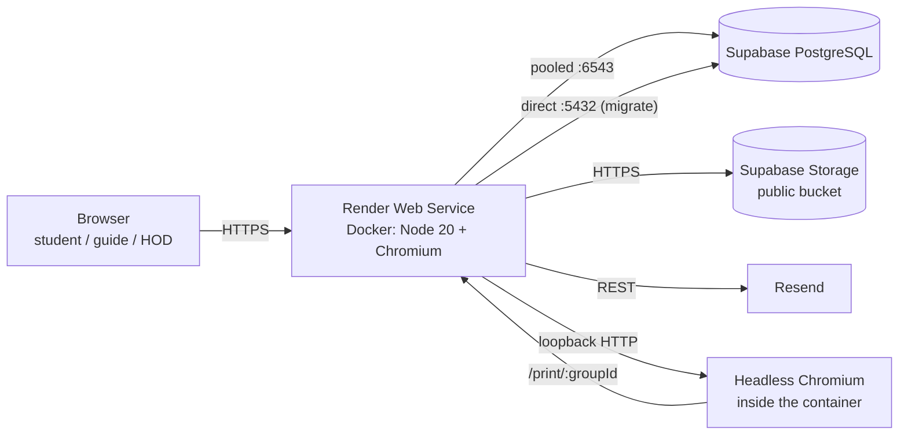

### 15.2 Build and runtime

- Multi-stage `Dockerfile`: deps → build (`prisma generate`, `next build`) → runner.
- Runner installs Chromium and Liberation fonts; `CHROME_PATH=/usr/bin/chromium`.
- Start command: `npx prisma migrate deploy && npm start`.
- `render.yaml` defines the service, health check, secrets and production env defaults.
- Supabase uses two URLs: pooled for the app, direct for migrations.

### 15.3 Environments

| Environment | Database | Uploads | Email | PDF |
|---|---|---|---|---|
| Local | PostgreSQL/Supabase or local Prisma database | `local` (`var/uploads`) | `console` | system Chrome |
| Test | isolated test database | `local` temp | `noop` | mocked / gate tests |
| Production | Supabase PostgreSQL | Supabase Storage | Resend or SMTP | Chromium in container |

### 15.4 Operational checklist

1. Set `DATABASE_URL`, `DIRECT_URL`, `NEXTAUTH_SECRET`, `NEXTAUTH_URL`.
2. Create the Supabase bucket and set `UPLOAD_PROVIDER="supabase"` + keys.
3. Set `EMAIL_PROVIDER` and credentials; verify the sender domain.
4. Set `NEXTAUTH_URL` (also used as the PDF render base) and `CHROME_PATH`; if you prefer a separate
   render URL, wire `PDF_BASE_URL` into `apps/web/app/api/groups/[groupId]/pdf/route.ts`.
5. Run migrations and seed once (HOD, 3 guides, 8 students, 2 groups, schedule, activity/review
   templates).
6. Back up database and object storage; monitor disk/DB limits.
7. Rotate secrets; never commit `.env`.

---

## 16. Testing and quality assurance

The test suite uses Vitest and an isolated database. Current status: **127 tests across 19 files**
(`npm test`).

| Requirement / rule | Representative tests |
|---|---|
| Signup cannot choose a role; duplicate email/roll rejected | `tests/auth.test.ts` |
| Email verification required; tokens single-use | `tests/auth.test.ts` |
| Rate/role routing | `tests/auth.test.ts` |
| Group: one group per student; max 4; invites; creator submits | `tests/group.test.ts` |
| Cover/member validation, photo limits, PDF lock | `tests/group-info.test.ts` |
| Rules/undertaking signatures and idempotency | `tests/signoff.test.ts` |
| Schedule edit permissions | `tests/schedule.test.ts` |
| Topic workflow and Topic 2 lock | `tests/topic.test.ts` |
| Activity lazy materialisation, two-step signature, reset/history | `tests/activity-chart.test.ts` |
| Marks/review permissions, submit signs, approved lock, HOD unlock reason | `tests/review.test.ts` |
| Mock/final totals, over-max refusal, transitions | `tests/evaluation.test.ts`, `tests/term2.test.ts` |
| Examiner feedback (both terms) | `tests/evaluation.test.ts`, `tests/term2.test.ts` |
| Competitions/papers/checklists/RTM/cost/notes | `tests/records.test.ts` |
| Sponsored gate, signatures, ratings | `tests/sponsored.test.ts` |
| Completion math and PDF permission | `tests/completion.test.ts` |
| PDF gate (stranger, incomplete, no permission) | `tests/pdf.test.ts` |
| Notifications and dedup | `tests/notifications.test.ts` |
| Role-scoped activity feed | `tests/activity.test.ts` |
| Gallery file handling | `tests/gallery.test.ts` |
| Formatting and JSON helpers | `tests/format.test.ts` |

Quality gates before release:

```bash
npm run typecheck
npm run lint
npm test
npm run build
```

Not yet present: Playwright/visual regression tests comparing screen and print rendering, and a CI
pipeline. These are listed in §17.

---

## 17. Known limitations and future work

### 17.1 Correctness and data integrity

1. **Application-enforced cardinalities.** “One group per student”, “max 4 members” and
   “unique roll/exam seat within a group” are checked in services but not by database constraints.
   Concurrent joins could race. Options: serializable transactions, advisory locks, or a unique
   partial index / trigger in PostgreSQL.
2. **JWT revocation.** Deactivating a user blocks future logins but does not invalidate an existing
   JWT. Add a token version / session table if immediate revocation is required.
3. **Audit immutability.** Audit rows are append-only by convention, not cryptographically chained.
   A DB administrator can alter them. Consider a hash chain or WORM storage for stronger evidence.
4. **Group status nuance.** `READY_FOR_PDF` is only written when permission is revoked from a
   complete group; readiness at other times is computed. This is intentional but can confuse
   reporting; a derived status field would simplify it.

### 17.2 Scale and operations

5. **In-memory rate limiter.** Replace with Redis for multiple instances/serverless.
6. **Synchronous PDF.** Move generation to a queue/worker; return a job id and store the artifact in
   object storage. This also avoids Puppeteer competing with page traffic.
7. **Completion cost.** Cache/snapshot per group and invalidate on write, especially for the HOD
   dashboard.
8. **Ephemeral local files.** On Render, `var/uploads` disappears on redeploy. Use Supabase Storage
   for photos and either store PDFs there or accept regeneration.
9. **No metrics/tracing.** Add structured logs, request ids, error tracking and alerts.

### 17.3 Product and UX

10. **One student can sign for the whole group** on rules/undertaking by design; if individual
    consent is legally required, add per-member confirmation (email/OTP).
11. **No separate external-examiner login.** Ratings are transcribed. A tokenised external form
    could reduce transcription errors.
12. **No visual regression tests.** Add Playwright screenshots for each sheet in screen and print
    modes, as required by the paper-page specification.
13. **No HOD-creation UI.** Guide accounts are created by the HOD, but additional HOD accounts must
    be provisioned directly in the database/seed. Add a protected HOD-management screen if needed.
14. **No offline mode or native app.** The paper UI is responsive but not editable offline.
15. **No CI/CD pipeline in the repo.** Add GitHub Actions for typecheck/lint/test/build and a
    preview deployment.

### 17.4 Security hardening

16. **Chrome sandbox disabled** in the container (`--no-sandbox`). Keep user content escaped, isolate
    the renderer, or use a maintained PDF service for a stronger boundary.
17. **Public storage bucket.** Certificates and photos are accessible to anyone with the URL. Use
    signed URLs/private buckets if evidence is sensitive.
18. **No malware scanning** for uploaded PDFs/images.
19. **Unused `PDF_BASE_URL`.** The PDF route currently uses `NEXTAUTH_URL` as the render base. This
    is safe when both point at the same origin, but the unused variable is a configuration trap;
    wire it through or remove it from `.env.example`.
20. **Flow-sheet continuation headers.** A long notes sheet grows past one A4 page, but the college
    header and page number are not repeated on its continuation pages. Split long content into
    explicit `PaperPage` blocks if the printed submission requires a header on every page.

---

## 18. Appendix: status and action catalogue

### 18.1 Status values

| Domain | Values |
|---|---|
| User role | `STUDENT`, `GUIDE`, `HOD` |
| Group | `DRAFT`, `SUBMITTED`, `ACTIVE`, `READY_FOR_PDF`, `PDF_ALLOWED`, `PDF_GENERATED` |
| Topic | `DRAFT`, `SUBMITTED`, `SCORED`, `APPROVED`, `REJECTED` |
| Activity entry | `PLANNED`, `STUDENT_CONFIRMED`, `GUIDE_VERIFIED` |
| Activity outcome | `COMPLETE`, `INCOMPLETE` |
| Review / marks workflow | `DRAFT`, `SUBMITTED`, `APPROVED` |
| Group invite | `PENDING`, `ACCEPTED`, `DECLINED`, `EXPIRED` |
| Examiner rating | `Excellent`, `Good`, `Satisfactory` |
| Sponsor rating | `HIGH`, `MEDIUM`, `LOW` |
| Competition type | `POSTER`, `DEMO`, `PAPER_PRESENTATION` |
| Member type | `creator`, `member` |
| Content page type | `RTM`, `COST`, `NOTE` |

### 18.2 Audit action names

| Module | Audit actions |
|---|---|
| Auth | `USER_SIGNUP`, `EMAIL_VERIFIED`, `PASSWORD_RESET` |
| Admin | `GUIDE_CREATE`, `GUIDE_UPDATE`, `USER_ACTIVATE`, `USER_DEACTIVATE`, `GROUP_APPROVE`, `GROUP_REJECT`, `GROUP_ASSIGN_GUIDE`, `GROUP_REASSIGN_GUIDE`, `GROUP_SPONSORED`, `GROUP_PDF_ALLOW`, `GROUP_PDF_REVOKE` |
| Group | `GROUP_CREATE`, `GROUP_INVITE`, `GROUP_INVITE_ACCEPT`, `GROUP_INVITE_DECLINE`, `GROUP_JOIN_CODE`, `GROUP_MEMBER_REMOVE`, `GROUP_SUBMIT` |
| Cover/members | `COVER_UPDATE`, `MEMBER_UPDATE`, `MEMBER_PHOTO_UPDATE` |
| Sign-offs | `RULES_ACK`, `UNDERTAKING_ACCEPT` |
| Schedule | `SCHEDULE_UPDATE` |
| Topics | `TOPIC_SAVE`, `TOPIC_SUBMIT`, `TOPIC_SCORE`, `TOPIC_APPROVE`, `TOPIC_REJECT` |
| Activity | `ENTRY_CONFIRM`, `ENTRY_VERIFY` |
| Reviews | `REVIEW_SAVE`, `REVIEW_SUBMIT`, `REVIEW_APPROVE`, `REVIEW_UNLOCK` |
| Evaluation | `MOCK_SAVE/SUBMIT/APPROVE/UNLOCK`, `FINAL_SAVE/SUBMIT/APPROVE/UNLOCK` |
| Examiner | `EXAMINER_SAVE` |
| Records | `COMPETITION_CREATE/UPDATE/DELETE/CERTIFICATE`, `PAPER_CREATE/UPDATE/DELETE/FILE`, `CHECKLIST_SAVE`, `CONTENT_SAVE`, `CONTENT_FILE`, `NOTE_CREATE/UPDATE/DELETE` |
| Sponsored | `MEETING_CREATE/UPDATE/DELETE/SIGN/GUIDE_SIGN/EXTERNAL_SIGN`, `SPONSOR_FEEDBACK_SAVE`, `SPONSOR_SEAL` |
| PDF | `PDF_GENERATE` |

These are the action names used by the audit screens and the activity feed. Add a new action to this
table whenever a new write path is introduced.

### 18.3 Source map

| Concern | Primary files |
|---|---|
| Schema / seed | `prisma/schema.prisma`, `prisma/seed.ts`, `prisma/seed-data/*` |
| Auth | `apps/web/lib/auth.ts`, `apps/web/lib/services/auth.ts`, `apps/web/lib/tokens.ts`, `apps/web/lib/password.ts`, `apps/web/lib/rate-limit.ts` |
| Permissions | `apps/web/lib/permissions.ts`, `apps/web/lib/roles.ts`, `apps/web/middleware.ts` |
| Group / admin | `apps/web/lib/services/group.ts`, `apps/web/lib/services/admin.ts`, `apps/web/lib/services/group-info.ts`, `apps/web/lib/services/signoff.ts` |
| Topics / activity | `apps/web/lib/services/topic.ts`, `apps/web/lib/services/activity-chart.ts` |
| Reviews / marks | `apps/web/lib/services/review.ts`, `apps/web/lib/services/evaluation.ts`, `apps/web/lib/services/mock.ts`, `apps/web/lib/services/final.ts`, `apps/web/lib/services/examiner.ts` |
| Records / sponsored | `apps/web/lib/services/records.ts`, `apps/web/lib/services/sponsored.ts`, `apps/web/lib/services/gallery.ts` |
| Completion | `apps/web/lib/completion/sections.ts`, `apps/web/lib/completion/index.ts` |
| PDF | `apps/web/lib/services/pdf.ts`, `apps/web/app/print/[groupId]/page.tsx`, `apps/web/app/api/groups/[groupId]/pdf/route.ts` |
| Paper UI | `apps/web/components/paper/*`, `apps/web/components/viewer/sheet-viewer.tsx`, `apps/web/app/globals.css` |
| Notifications | `apps/web/lib/services/notifications.ts`, `apps/web/lib/email.ts`, `apps/web/components/app/notifications-bell.tsx` |
| Audit / activity | `apps/web/lib/audit.ts`, `apps/web/lib/services/activity.ts` |
| Deployment | `Dockerfile`, `render.yaml`, `.env.example`, `README.md` |

---

*End of document.*
