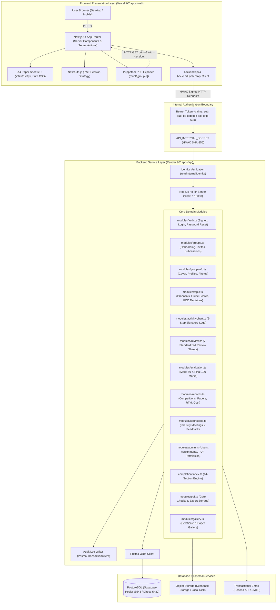
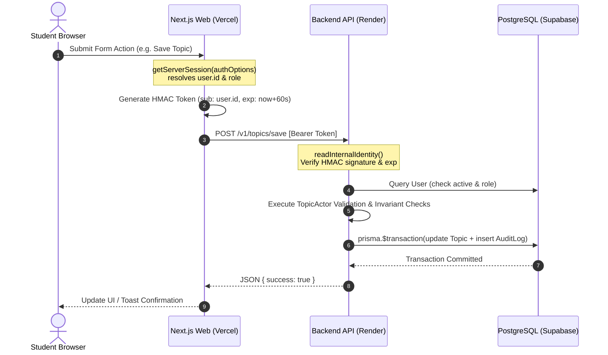
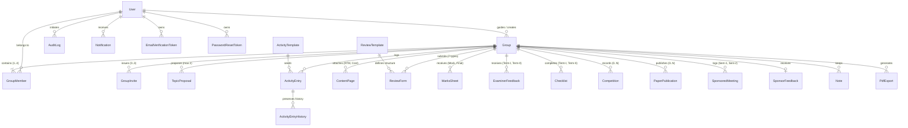
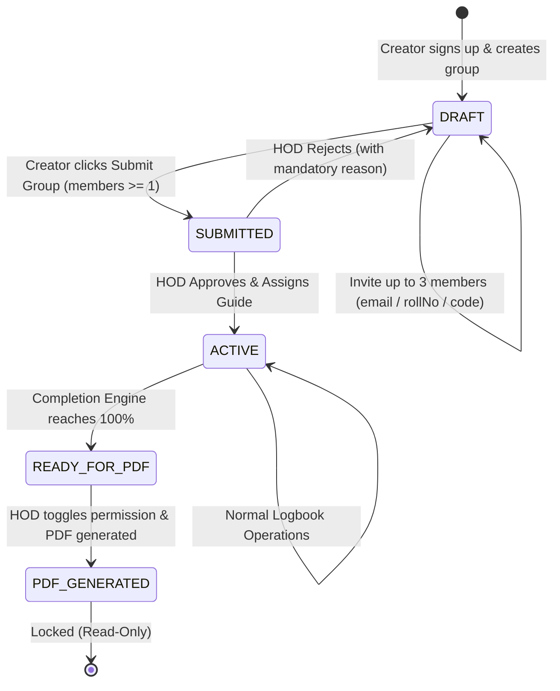
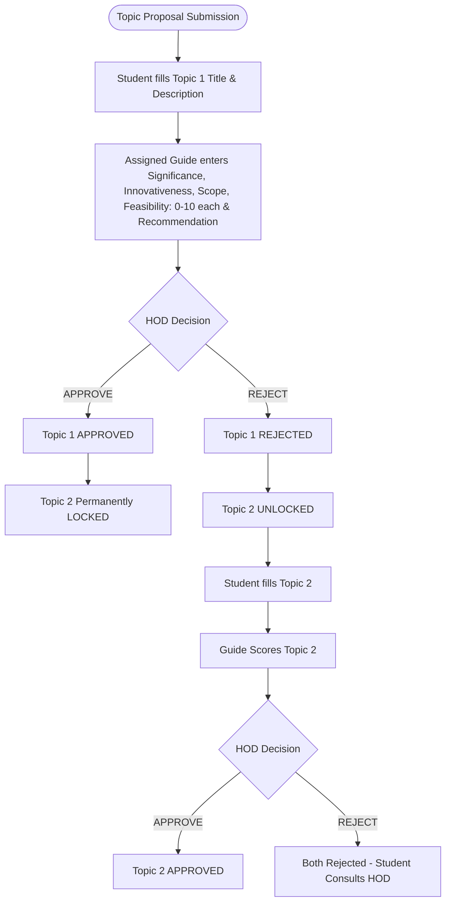
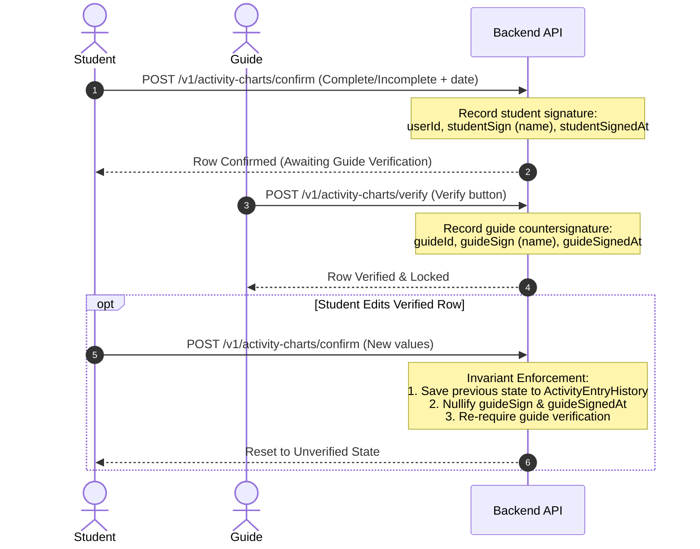
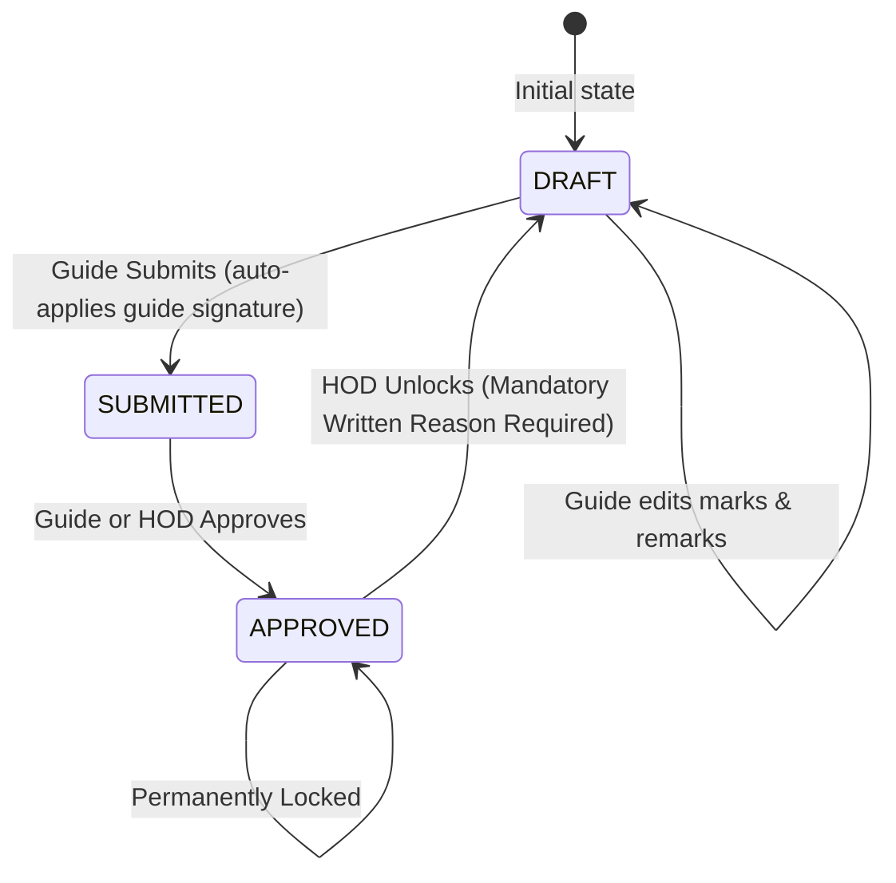
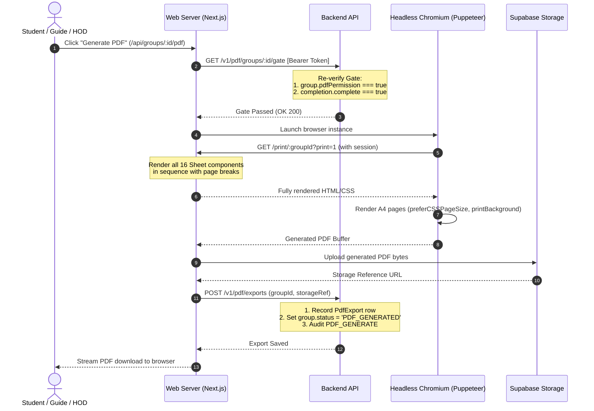
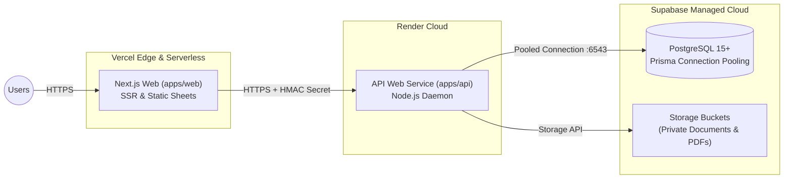

# Digital BE Project Log Book — System Design Document (SDD)

| | |
|---|---|
| **Document** | System Design Document (SDD) — Two-Tier Architecture |
| **System** | Digital BE Project Log Book |
| **Institution** | Anantrao Pawar College of Engineering & Research (ABMSP), Pune |
| **Department** | Computer Engineering |
| **Source Specification** | Project Diary, Record No. `ACA/D/003B`, Revision `00`, DoI `01/02/2025` |
| **Version** | 2.0 (Separated Frontend / Backend Architecture) |
| **Date** | 29 October 2026 |
| **Status** | Active — Reflects the implemented codebase in this repository |

---

## Table of Contents

1. [Executive Summary & Purpose](#1-executive-summary--purpose)
2. [Actors, Roles & Responsibilities](#2-actors-roles--responsibilities)
3. [System Architecture](#3-system-architecture)
4. [Authentication & Internal Communication Boundary](#4-authentication--internal-communication-boundary)
5. [Data Architecture & Database Design](#5-data-architecture--database-design)
6. [Core Workflows & State Machines](#6-core-workflows--state-machines)
7. [Module-by-Module Technical Design](#7-module-by-module-technical-design)
8. [Completion Engine & Eligibility Matrix](#8-completion-engine--eligibility-matrix)
9. [Paper-Page UI & PDF Export Subsystem](#9-paper-page-ui--pdf-export-subsystem)
10. [Audit Logging & Notification Subsystems](#10-audit-logging--notification-subsystems)
11. [API Endpoints Specification](#11-api-endpoints-specification)
12. [Security, Authorization & Integrity Guarantees](#12-security-authorization--integrity-guarantees)
13. [Deployment & Infrastructure Architecture](#13-deployment--infrastructure-architecture)
14. [Testing & Quality Assurance](#14-testing--quality-assurance)

---

## 1. Executive Summary & Purpose

### 1.1 Context & Problem Statement
The Department of Computer Engineering at Anantrao Pawar College of Engineering & Research (APCOE&R) maintains a physical paper **Project Diary** (Record No. `ACA/D/003B`, Revision `00`, DoI `01/02/2025`) for every final-year Bachelor of Engineering (BE) project group. Over the two-semester project lifecycle (Term-I and Term-II), students and faculty maintain manual records across 16 distinct sections:
- Group creation, profile details, and passport photos
- Static 13 department rules and digital undertakings
- Topic finalization (Topic 1 and Topic 2) with multi-criteria guide evaluation
- Monthly activity logs (June to March, May-June) requiring two-step signatures
- Requirement Traceability Matrix (RTM) and project cost estimations
- 7 standardized reviews and evaluation mark sheets (Mock 50 marks, Final 100 marks)
- External examiner feedback, submission checklists, competition evidence, and research paper publication
- Sponsored industry projects meeting logs and company feedback

Physical paper diaries suffer from:
1. **Lack of Truth & Version Skew:** Signatures, dates, and marks can be manipulated, back-dated, or lost.
2. **Weak Workflow Enforcement:** Paper diaries cannot physically prevent students from entering marks, prevent guides from editing locked reviews, or stop students from submitting for exam evaluation without meeting mandatory prerequisites (e.g. competition entries).
3. **Absence of Auditability:** Historical edits cannot be audited, and reasons for marks adjustments cannot be reconstructed.

### 1.2 System Goals
- **High-Fidelity Digital Replica:** Render every section inside an authentic A4 paper sheet (`794 × 1123 px`) matching the exact typographical and tabular layout of the college diary.
- **Strict Two-Tier Decoupled Architecture:** Cleanly separate the web presentation client (`apps/web` on Vercel) from the backend business logic and database persistence service (`apps/api` on Render).
- **Enforced State Machines:** Strict state transitions for groups (`DRAFT` → `SUBMITTED` → `ACTIVE` → `READY_FOR_PDF` → `PDF_GENERATED`), topics, activity entries, reviews, and evaluation sheets.
- **Role-Based Server Authorization:** Absolute server-authoritative permission checks. Client UI hides buttons for convenience, but the API rejects any unauthorized read or mutation.
- **Automated Objective Completion Engine:** Automatically track 14 mandatory sections and evaluate exam eligibility.
- **Unified Rendering Pipeline:** The exact same React Sheet components rendered in the browser are printed directly to A4 PDF using headless Chromium (Puppeteer), ensuring zero visual divergence.

---

## 2. Actors, Roles & Responsibilities

| Actor / Role | Authentication | Primary Responsibilities | Strict Invariants & Prohibitions |
|---|---|---|---|
| **STUDENT** | Self sign-up (verified email required) | <ul><li>Create or join exactly one group (max 4 students).</li><li>Enter project metadata (title, area, department).</li><li>Upload passport photo and profile info.</li><li>Acknowledge 13 rules and accept digital undertaking.</li><li>Submit Topic 1 (and Topic 2 if Topic 1 is rejected).</li><li>Log and confirm monthly activity entries.</li><li>Upload RTM, cost sheets, papers, competition certificates.</li><li>Record sponsored meetings and feedback.</li><li>Download approved final PDF logbook.</li></ul> | <ul><li>Cannot enter, alter, or view draft marks/grades.</li><li>Cannot verify activity entries or score topics.</li><li>Cannot approve or reject groups or topics.</li><li>Cannot bypass competition eligibility.</li><li>Cannot edit sheets once PDF is generated.</li></ul> |
| **GUIDE** (Faculty Reviewer) | Provisioned exclusively by HOD | <ul><li>Verify and countersign monthly student activity entries.</li><li>Evaluate topic proposals across 4 parameters (0–10).</li><li>Conduct and grade 7 standardized reviews.</li><li>Award Term-I Mock marks (out of 50) and Term-II Final marks (out of 100).</li><li>Sign sponsored meeting minutes.</li><li>Record external examiner feedback.</li></ul> | <ul><li>May only access and evaluate **assigned** groups.</li><li>Cannot approve/reject topics (HOD only).</li><li>Cannot unlock approved/locked marks (HOD only).</li><li>Cannot toggle PDF permissions.</li><li>Cannot create or manage users.</li></ul> |
| **HOD** (Head of Department) | Pre-seeded / Database administrator | <ul><li>Create and manage GUIDE accounts.</li><li>Approve or reject submitted student groups.</li><li>Assign exactly ONE guide per approved group.</li><li>Final approve or reject topic proposals.</li><li>Approve group marks sheets.</li><li>Unlock approved marks sheets (requires mandatory written audit reason).</li><li>Toggle sponsored status and `pdfPermission`.</li><li>Manage departmental academic schedule dates.</li><li>Inspect complete audit logs and media galleries.</li></ul> | <ul><li>Cannot enter or edit review marks, grades, remarks, or topic scores.</li><li>Cannot bypass completion engine when toggling PDF permission.</li><li>Cannot create additional HOD accounts via UI.</li></ul> |

---

## 3. System Architecture

The system is deployed across two independent tiers connected via a secure, authenticated internal HTTP boundary.



### 3.1 Tier Separation Responsibilities

#### Frontend Web Application (`apps/web`)
- **Technology:** Next.js 14 App Router, TypeScript, Tailwind CSS, shadcn/ui (for outer chrome only).
- **Responsibilities:**
  - Route handlers, layouts, and page templates.
  - Authentic A4 paper page layout with serif typography and 1px borders.
  - Interactive client islands (forms, signature triggers, autosave, zoom/navigation).
  - NextAuth session handling (session token stored in HTTP-only cookies).
  - Headless Puppeteer browser orchestration for PDF rendering via `/print/[groupId]`.
- **Constraint:** Zero direct Prisma database queries. All data retrieval and mutations delegate to the backend API via `backendApi` or `backendSystemApi`.

#### Backend API Service (`apps/api`)
- **Technology:** Node.js native HTTP server, TypeScript, Zod, Prisma ORM, bcryptjs.
- **Responsibilities:**
  - All database queries and schema management.
  - Transactional integrity (`prisma.$transaction`) across multi-table operations.
  - Business invariant enforcement and role-based permissions.
  - Immutable audit trail recording (`AuditLog`).
  - Section completion evaluation and exam eligibility computation.
  - File storage interactions (local disk in dev, Supabase Private Buckets in prod).
  - Transactional email delivery (Resend REST API or SMTP).

---

## 4. Authentication & Internal Communication Boundary

### 4.1 Client Session Authentication (User → Vercel)
User authentication is managed by NextAuth using credentials (email and password) with a JWT session strategy:
1. Student enters credentials on `/login`.
2. NextAuth `authorize` callback triggers `authenticate(email, password)` in `apps/web/lib/services/auth.ts`.
3. `services/auth.ts` calls backend endpoint `POST /v1/auth/login`.
4. The backend verifies bcrypt password hash, active status, and email verification.
5. On success, backend returns `{ ok: true, user: { id, name, email, role } }`.
6. NextAuth issues a signed JWT cookie containing `{ id, role }`.
7. `apps/web/middleware.ts` guards route prefixes:
   - `/student/*` → Requires `role === "STUDENT"`
   - `/guide/*` → Requires `role === "GUIDE"`
   - `/hod/*` → Requires `role === "HOD"`

### 4.2 Internal Service-to-Service Authentication (Vercel → Render)
All calls from `apps/web` to `apps/api` are authenticated using a shared secret HMAC SHA-256 token:

```
Authorization: Bearer <base64url(payload)>.<base64url(hmac_sha256(payload, API_INTERNAL_SECRET))>
```

- **Payload Claims:**
  - `sub`: User ID of the authenticated caller, or `"system"` for unauthenticated flows (e.g. login, signup, password reset).
  - `aud`: Fixed audience string `"be-logbook-api"`.
  - `exp`: Short-lived expiration timestamp (current epoch seconds + 60s).
- **Backend Verification (`readInternalIdentity`):**
  1. Verifies Bearer header presence.
  2. Recomputes HMAC using `API_INTERNAL_SECRET`.
  3. Validates signature with constant-time equality check (`timingSafeEqual`) to prevent timing attacks.
  4. Parses payload and rejects expired or wrong-audience tokens.
  5. Resolves user from database via `authenticatedUser(request)` to ensure account is active and role is valid.



---

## 5. Data Architecture & Database Design

### 5.1 Portable Schema Strategy
To ensure zero vendor lock-in and seamless transition between SQLite (local development/tests) and PostgreSQL (production Supabase/Render):
1. **String-Encoded Enums:** Roles, group statuses, review types, and terms are stored as `String` columns. Valid values are declared in `constants.ts` and validated with Zod.
2. **String-Encoded JSON:** Flexible tabular structures (`components`, `answers`, `items`, `ratings`, `snapshot`, `before`, `after`) are stored in text columns holding valid JSON. All serialization/deserialization passes through `json.ts` (`toJson` / `fromJson`).

### 5.2 Entity-Relationship Diagram



### 5.3 Core Entities Specification

#### `User`
- `id` (String, PK, CUID)
- `name` (String, max 100)
- `email` (String, unique, lowercase)
- `rollNo` (String, optional, unique)
- `mobile` (String, optional, 10 digits)
- `passwordHash` (String, bcrypt)
- `role` (String: `STUDENT` | `GUIDE` | `HOD`)
- `active` (Boolean, default true)
- `emailVerifiedAt` (DateTime, optional)
- `createdVia` (String: `SELF_SIGNUP` | `HOD_CREATED` | `SEED`)

#### `Group`
- `id` (String, PK, CUID)
- `code` (String, unique, 6-character alphanumeric join code)
- `groupNo` (String, optional, allocated by HOD e.g. "B-04")
- `academicYear` (String e.g. "2025-2026")
- `department` (String e.g. "Computer Engineering")
- `projectTitle` (String, max 200)
- `area` (String, max 120 e.g. "Machine Learning / Cloud")
- `status` (String: `DRAFT` | `SUBMITTED` | `ACTIVE` | `READY_FOR_PDF` | `PDF_GENERATED`)
- `rejectReason` (String, optional, written by HOD)
- `creatorId` (String, FK -> User)
- `guideId` (String, optional, FK -> User)
- `isSponsored` (Boolean, default false)
- `pdfPermission` (Boolean, default false)

#### `GroupMember`
- `id` (String, PK, CUID)
- `groupId` (String, FK -> Group)
- `userId` (String, FK -> User)
- `memberType` (String: `CREATOR` | `INVITED`)
- `teResult` (String, max 60)
- `examSeatNo` (String, optional, unique)
- `contribution` (String, max 500)
- `photoUrl` (String, optional)
- `rulesAckAt` (DateTime, optional, digital signature timestamp)
- `undertakingAcceptedAt` (DateTime, optional, digital signature timestamp)

---

## 6. Core Workflows & State Machines

### 6.1 Group Formation & Guide Assignment Workflow
A student belongs to at most one group. Groups have at most 4 members and exactly one guide.



### 6.2 Topic Selection & Dual-Topic Lock Rules
Students submit project proposals. Guide evaluates criteria (0–10 each), HOD makes final approval.



### 6.3 Two-Step Activity Chart Signature & Mutation Invariant
Pre-seeded monthly activities require a strict two-step digital signature:



### 6.4 Marks Workflow (Reviews, Mock Term-I, Final Term-II)
Every Review form and evaluation MarksSheet enforces an immutable three-state lifecycle:



- **Invariant 1:** Only the assigned guide can write marks, grades, and remarks.
- **Invariant 2:** `APPROVED` state is immutable. No faculty member can alter marks while approved.
- **Invariant 3:** Only the HOD can unlock an approved sheet, which requires a mandatory written justification and logs an `AuditLog` row before reverting the state to `DRAFT`.

---

## 7. Module-by-Module Technical Design

### M1. Cover Page
- **Fields:** Department, Academic Year, Group No, Project Title, Area of Project, Guide Name.
- **Storage:** Persisted in `Group` entity. Editable by group members while status is `DRAFT` or `ACTIVE`.

### M2. Rules & Regulations
- **Specification:** Exact static 13 rules from Record No. `ACA/D/003B`.
- **Signature:** Each member clicks digital acknowledgment once (`rulesAckAt` timestamp recorded).

### M3. Group Information
- **Fields:** Up to 4 members. Name, TE Result, Roll No, Mobile (10 digits), Exam Seat No, Email, Project Contribution, Passport Photo (JPG/PNG, max 2MB).
- **Validation:** Server enforces uniqueness for roll number and exam seat number across the department.

### M4. Undertaking
- **Specification:** Mandatory academic integrity statement from logbook.
- **Signature:** Digital acceptance per member (`undertakingAcceptedAt` recorded).

### M5. Departmental Schedule
- **Specification:** Semester I (8 milestones) and Semester II (7 milestones).
- **Access Control:** Dates and remarks editable exclusively by HOD; read-only for students and guides.

### M6. Topic Finalization
- **Topic 1 & Topic 2:** Title, Description.
- **Guide Evaluation (0–10 each):** Significance, Innovativeness, Scope, Feasibility (Total 40). Recommendation (Yes/No).
- **HOD Action:** Approve / Reject with remarks.

### M7. Monthly Activity Charts & Technical Content
- **Tabs:** June to March, May-June (April omitted per syllabus).
- **Columns:** Date, Planned Activity, Complete/Incomplete status, Student Sign, Guide Sign.
- **Pages:** Requirement Traceability Matrix (RTM) and Project Cost Estimation (rich text + attachments).

### M8. Standardized Reviews (7 Reviews)
1. **Term-I Review I** (10 questions)
2. **Term-I Review II** (12 questions)
3. **Term-I Final / Design** (17 questions)
4. **Term-II Review I** (13 questions)
5. **Term-II Review II** (10 questions, with date)
6. **Term-II Final Validation** (9 questions, with date)
7. **Term-II Report Writing** (9 questions, with date)
- **Data Structure:** Each row stores question text, guide remark, grade (A/B/C/D), and guide signature.

### M9. Mock Evaluation Term-I (50 Marks per Member)
- Problem Statement / Scope / Feasibility: 5 marks
- Literature Survey: 5 marks
- Requirement Analysis: 5 marks
- Modeling and Designing: 10 marks
- Planning and Prototyping: 5 marks
- Presentation and Q&A: 10 marks
- Partial Project Report: 10 marks
- *Two committee faculty signatures recorded.*

### M10. Final Evaluation Term-II (100 Marks per Member)
- Modeling: 10 marks
- Coding and Implementation: 40 marks
- Testing: 10 marks
- Understanding / Individual Involvement: 10 marks
- Team Work: 10 marks
- Demonstration cum Presentation: 10 marks
- Documents and Report: 10 marks

### M11. External Examiner Feedback (Term-I & Term-II)
- 9 evaluation parameters rated Excellent / Good / Satisfactory.
- General observations and remarks.
- Guide signs and records external examiner's full name.

### M12. Submission Checklists
- **Term-I (5 items):** Report copy, presentation slides, paper draft, etc.
- **Term-II (8 items):** Final bound report, CD contents (code, documentation, dataset), etc.

### M13. Competition Participation
- Competition Name, Date, Organizing College, Level (State / National / International), Type (Poster / Demo / Paper Presentation), Award or Participation, Certificate Upload (PDF/JPG, max 5MB).
- **Critical Rule:** Minimum 1 competition entry is required for final exam eligibility.

### M14. Paper Publication
- Paper Title, Journal / Conference Name, ISSN / ISBN, Volume / Issue, Page Numbers, Published Paper PDF Upload (max 10MB).

### M15. Sponsored Project Subsystem (Conditional on `group.isSponsored`)
- **Semester 1 & 2 Meeting Logs:** Meeting Date, Industry Guide Name, Discussion Points, Action Plan, 3-way signatures (Student, Guide, Industry Representative).
- **Company Feedback:** 7 parameters rated High / Medium / Low, Company Seal scan upload.

### M16. Notes Page
- Free-form notes and observations created by students or guides.

---

## 8. Completion Engine & Eligibility Matrix

The backend API runs an automated completion engine aggregating 14 module evaluators:

```
getGroupCompletion(groupId: string): Promise<GroupCompletion>
```

| Section Key | Module Label | Criteria for 100% Complete |
|---|---|---|
| `cover` | Cover Page | All metadata filled (Title, Area, Year, Department, Group No). |
| `members` | Group Information | 1–4 members; all have names, roll numbers, mobile, and photos. |
| `rules` | Rules & Regulations | 100% of enrolled group members have acknowledged rules. |
| `undertaking` | Undertaking | 100% of enrolled group members have accepted the undertaking. |
| `topics` | Topic Finalization | Exactly one topic is in `APPROVED` status. |
| `activity` | Activity Charts | All pre-seeded entries are marked Complete/Incomplete and verified by Guide. |
| `rtm` | Traceability Matrix | RTM content page has text or uploaded matrix document. |
| `cost` | Cost Estimation | Cost estimation content page has text or uploaded estimation. |
| `reviews` | Standardized Reviews | All 7 review forms are in `APPROVED` status. |
| `evaluation` | Evaluations | Both Mock Term-I and Final Term-II mark sheets are `APPROVED` for all members. |
| `examiner` | Examiner Feedback | Both Term-I and Term-II examiner feedback forms recorded. |
| `checklists` | Submission Checklists | All 5 Term-I and all 8 Term-II checklist items ticked. |
| `competitions` | Competitions | At least 1 competition participation entry recorded. |
| `papers` | Paper Publication | At least 1 research paper publication record. |
| `sponsored` | Sponsored Details | *(Only if isSponsored)* Meeting logs recorded and sponsor feedback saved. |

### Final Exam Eligibility Rule
$$\text{Eligible for Final Exam} \iff \text{Count}(\text{Competitions}) \ge 1$$
If a group has 0 competition entries, the dashboard displays a prominent red warning: *"Not eligible for final exam"*.

---

## 9. Paper-Page UI & PDF Export Subsystem

### 9.1 Paper-Page UI Requirement
Every logbook screen renders inside a centralized `<PaperPage>` component:
- **Dimensions:** Strict A4 ratio (`794px × 1123px`), white background with subtle shadow on neutral grey backdrop.
- **Repeating Header Table:**
  - Left: ABMSP Sanstha Logo.
  - Center: *"Akhil Bharatiya Maratha Shikshan Parishad's / Anantrao Pawar College of Engineering & Research / Parvati, Pune - 09"*.
  - Sub-row: *"Record No.: ACA/D/003B / Revision: 00 / DoI: 01/02/2025"*.
  - Right: College Seal / Portrait Logo.
  - Sub-bar: Full-width neutral grey bar with centered bold *"Project Diary"*.
- **Typography:** Times New Roman / Liberation Serif for table body and labels; Arial Bold for titles. Black ink on white paper.
- **Inputs:** Fillable dotted/underline lines (`Field` component) that blend seamlessly into the paper.

### 9.2 PDF Export Pipeline
The PDF generator guarantees visual parity by printing the exact same React components:



---

## 10. Audit Logging & Notification Subsystems

### 10.1 Immutable Audit Log
Every critical mutation writes an append-only row to `AuditLog`:
- `id`: CUID primary key
- `userId`: Initiator ID
- `action`: Standardized verb (`USER_SIGNUP`, `GROUP_CREATE`, `GROUP_SUBMIT`, `GROUP_APPROVE`, `GUIDE_ASSIGN`, `TOPIC_SCORE`, `TOPIC_APPROVE`, `ENTRY_CONFIRM`, `ENTRY_VERIFY`, `REVIEW_SUBMIT`, `MARKS_APPROVE`, `MARKS_UNLOCK`, `PDF_GENERATE`, etc.)
- `entity`: Target model name (`User`, `Group`, `ReviewForm`, `MarksSheet`, `TopicProposal`, etc.)
- `entityId`: Primary key of modified entity
- `before`: JSON snapshot of entity state prior to change
- `after`: JSON snapshot of entity state after change
- `timestamp`: UTC timestamp

### 10.2 Notification Delivery
The system issues real-time in-app notifications and transactional emails:
- **In-App:** Stored in `Notification` table; read/unread feed in the top navigation bell.
- **Email Delivery:**
  - Local Dev / Test: `console` or `noop` provider.
  - Production: Resend REST API or SMTP with HTML templates.

---

## 11. API Endpoints Specification

All backend endpoints are hosted on Render under `/v1/*` and require HMAC Bearer authentication.

| Method | Path | Access | Description |
|---|---|---|---|
| `POST` | `/v1/auth/signup` | System | Student self sign-up |
| `POST` | `/v1/auth/login` | System | Verifies credentials |
| `POST` | `/v1/auth/verify-email` | System | Consumes email verification token |
| `POST` | `/v1/auth/forgot-password` | System | Initiates password reset |
| `POST` | `/v1/auth/reset-password` | System | Completes password reset |
| `GET` | `/v1/groups/onboarding` | Student | Retrieves student's group & pending invites |
| `GET` | `/v1/groups/:groupId/info` | Member / Guide / HOD | Retrieves group details, guide, and members |
| `POST` | `/v1/groups` | Student | Creates new group |
| `POST` | `/v1/groups/invites` | Group Creator | Invites student by email or roll number |
| `POST` | `/v1/groups/invites/accept` | Student | Accepts group invite |
| `POST` | `/v1/groups/invites/decline` | Student | Declines group invite |
| `POST` | `/v1/groups/join-by-code` | Student | Joins group via 6-digit code |
| `DELETE`| `/v1/groups/members/:id` | Group Creator | Removes member from draft group |
| `POST` | `/v1/groups/submit` | Group Creator | Submits group for HOD approval |
| `GET` | `/v1/student/group-info` | Student | Retrieves cover and profile info |
| `POST` | `/v1/student/group-info/cover` | Member | Updates cover metadata |
| `POST` | `/v1/student/group-info/member` | Member | Updates member profile details |
| `PUT` | `/v1/student/group-info/members/:id/photo` | Member | Uploads passport photo (2MB max) |
| `POST` | `/v1/signoff/rules` | Member | Acknowledges 13 rules |
| `POST` | `/v1/signoff/undertaking` | Member | Accepts digital undertaking |
| `GET` | `/v1/topics/sheet/:groupId` | Member / Guide / HOD | Loads Topic 1 & Topic 2 sheet |
| `POST` | `/v1/topics/save` | Member | Saves topic title & description |
| `POST` | `/v1/topics/score` | Assigned Guide | Scores topic parameters (0-10) |
| `POST` | `/v1/topics/decide` | HOD | Approves or rejects topic |
| `GET` | `/v1/activity-charts/groups/:id/:month` | Member / Guide / HOD | Loads monthly activity sheet |
| `POST` | `/v1/activity-charts/confirm` | Member | Student confirms entry |
| `POST` | `/v1/activity-charts/verify` | Assigned Guide | Guide verifies entry |
| `GET` | `/v1/reviews/groups/:id/:type` | Member / Guide / HOD | Loads standardized review sheet |
| `POST` | `/v1/reviews/draft` | Assigned Guide | Saves review draft |
| `POST` | `/v1/reviews/submit` | Assigned Guide | Submits review (auto-signs questions) |
| `POST` | `/v1/reviews/approve` | Assigned Guide / HOD | Approves and locks review |
| `POST` | `/v1/reviews/unlock` | HOD | Unlocks review (requires reason) |
| `GET` | `/v1/evaluation/mock/:id` | Member / Guide / HOD | Loads Mock Evaluation Term-I sheet |
| `POST` | `/v1/evaluation/mock/save` | Assigned Guide | Saves Mock evaluation marks |
| `GET` | `/v1/evaluation/final/:id` | Member / Guide / HOD | Loads Final Evaluation Term-II sheet |
| `POST` | `/v1/evaluation/final/save` | Assigned Guide | Saves Final evaluation marks |
| `GET` | `/v1/records/groups/:id` | Member / Guide / HOD | Retrieves records, papers, competitions |
| `POST` | `/v1/records/competitions` | Member | Adds competition entry |
| `POST` | `/v1/records/papers` | Member | Adds published paper record |
| `POST` | `/v1/records/content` | Member | Saves RTM or Cost estimation text |
| `POST` | `/v1/records/notes` | Member / Guide | Adds notes entry |
| `GET` | `/v1/sponsored/groups/:id` | Member / Guide / HOD | Loads sponsored meeting & feedback sheet |
| `POST` | `/v1/sponsored/meetings` | Member | Saves industry meeting minutes |
| `POST` | `/v1/sponsored/meetings/sign-guide` | Assigned Guide | Countersigns sponsored meeting |
| `POST` | `/v1/sponsored/feedback` | Member | Saves company ratings & details |
| `GET` | `/v1/admin/dashboard` | HOD | Retrieves live HOD metrics |
| `GET` | `/v1/admin/users` | HOD | Lists system users |
| `POST` | `/v1/admin/guides` | HOD | Creates new GUIDE account |
| `GET` | `/v1/admin/groups` | HOD | Lists departmental groups |
| `POST` | `/v1/admin/groups/:id/approve` | HOD | Approves submitted group |
| `POST` | `/v1/admin/groups/:id/reject` | HOD | Rejects group with reason |
| `POST` | `/v1/admin/assignments` | HOD | Assigns faculty guide to group |
| `POST` | `/v1/admin/groups/:id/pdf-permission` | HOD | Toggles PDF permission (enforces completion) |
| `GET` | `/v1/completion/groups/:id` | Member / Guide / HOD | Returns group completion breakdown |
| `GET` | `/v1/pdf/groups/:id/gate` | Member / Guide / HOD | Verifies gate prerequisites |
| `GET` | `/v1/pdf/groups/:id/exports` | Member / Guide / HOD | Lists historical PDF exports |
| `POST` | `/v1/pdf/exports` | Member / Guide / HOD | Records export & locks logbook |

---

## 12. Security, Authorization & Integrity Guarantees

1. **Server-Authoritative Enforcement:** UI element hiding is purely decorative. Every single route and action re-verifies the caller's session, assigned guide status, group status, and section lock status.
2. **Marks Protection Invariant:** Students, HODs, and unassigned guides receive an immediate `403 Forbidden` if attempting to enter marks.
3. **Single Active Group Rule:** A student cannot create or join a group if they already have an active membership. Database transactions lock records during group joins.
4. **Single-Use Cryptographic Tokens:** Password reset and email verification links utilize 32-byte cryptographic random tokens. Only the SHA-256 hash is persisted in the database, preventing token leakage from database backups.
5. **Rate Limiting:** Auth endpoints (login, signup, reset) are protected by rate limiters to mitigate credential stuffing and brute-force attacks.

---

## 13. Deployment & Infrastructure Architecture



### Environment Variables Configuration

#### Frontend (`apps/web` on Vercel)
- `NEXTAUTH_SECRET`: Secret used to sign NextAuth session JWTs.
- `NEXTAUTH_URL`: Canonical public URL of the web application.
- `API_BASE_URL`: Base URL of the Render API (e.g. `https://api.domain.com`).
- `API_INTERNAL_SECRET`: 64+ char shared secret matching Render.
- `UPSTASH_REDIS_REST_URL` & `TOKEN`: Distributed rate limiter for auth routes.
- `PDF_BASE_URL`: Base URL for Puppeteer renderer.
- `UPLOAD_PROVIDER`: `supabase` in production (`local` in dev).
- `SUPABASE_URL`, `SUPABASE_SERVICE_ROLE_KEY`, `SUPABASE_BUCKET`, `SUPABASE_PDF_BUCKET`: Storage parameters.

#### Backend API (`apps/api` on Render)
- `PORT`: Service port (Render defaults to `10000`).
- `API_ALLOWED_ORIGINS`: Comma-separated list of allowed web origins (e.g. `https://be-logbook.vercel.app`).
- `API_INTERNAL_SECRET`: Shared secret used to verify incoming HMAC Bearer tokens.
- `DATABASE_URL`: Transaction-pooled PostgreSQL connection string (`pgbouncer=true`).
- `DIRECT_URL`: Session-mode PostgreSQL connection string (port `5432` for Prisma migrations).
- `WEB_URL`: Frontend public URL (used to format verification and reset email links).
- `ALLOWED_EMAIL_DOMAIN`: College domain restriction (e.g. `apcoer.edu.in`).
- `REQUIRE_EMAIL_VERIFICATION`: `true` in production (`false` in demo mode).
- `EMAIL_PROVIDER`: `resend`, `smtp`, or `console`.
- `EMAIL_FROM`, `RESEND_API_KEY`, `SMTP_*`: Transactional mailer parameters.
- `UPLOAD_PROVIDER`, `SUPABASE_*`: Storage access parameters.

---

## 14. Testing & Quality Assurance

The codebase maintains strict quality gates across both workspaces:

1. **Static Typechecking:**
   - Command: `npm run typecheck`
   - Scope: Evaluates `@be-logbook/web` and `@be-logbook/api` in strict TypeScript mode with zero tolerance for `any` escapes or type errors.
2. **ESLint & Code Standards:**
   - Command: `npm run lint`
   - Scope: Enforces Next.js App Router rules and React best practices.
3. **API Compilation:**
   - Command: `npm run api:build`
   - Scope: Compiles backend TypeScript to `apps/api/dist` cleanly.
4. **Production Web Build:**
   - Command: `npm run build`
   - Scope: Executes Next.js 14 production build, optimizing all 56 static and dynamic application routes.
5. **Formatting & Diff Integrity:**
   - Command: `git diff --check`
   - Scope: Ensures zero trailing whitespace, clean newline termination, and absence of merge markers.
6. **Integration Test Suite:**
   - Suite: Vitest (`npm test`).
   - Coverage: Proves permissions, marks immutability, dual-topic lock, activity history preservation, completion aggregation, and PDF gating.
